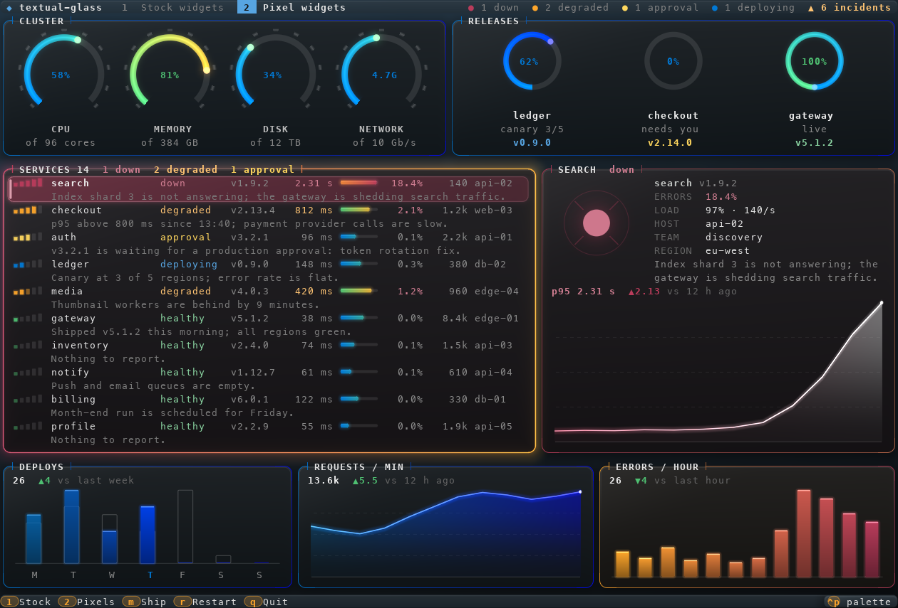
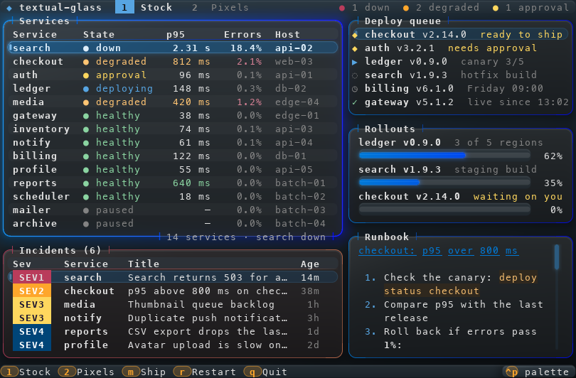
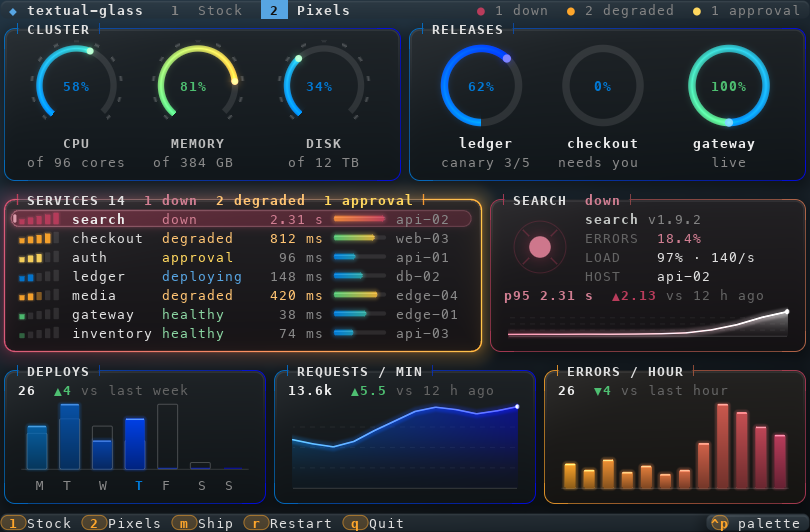
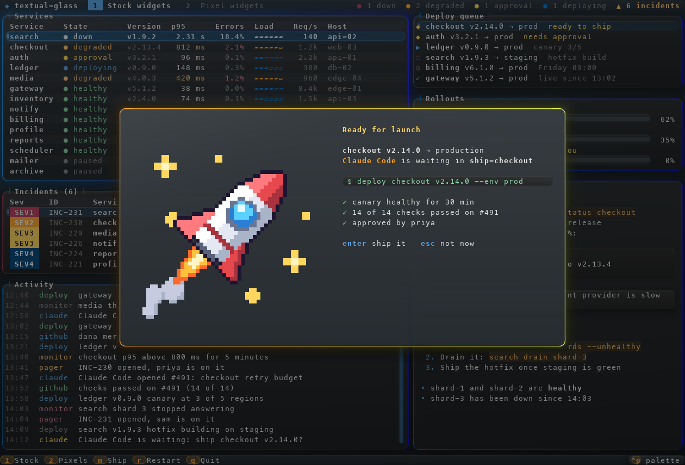
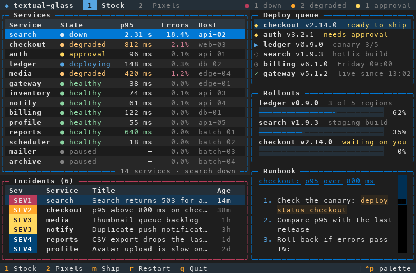

# textual-glass

A pixel "glass" look for ordinary [Textual](https://textual.textualize.io) apps, drawn through the kitty graphics protocol and tuned for Ghostty 1.4. Add one mixin and your app gets glass panels with gradient borders, a focus glow, a selection pill that slides between rows, glowing progress bars, slim scrollbars, key badges in the footer, and a dimming scrim under modal screens. Your widgets, CSS and layout stay stock Textual, and Textual still draws all the text. The glass is drawn in pixels underneath it. In any other terminal nothing changes at all.

```python
from textual.app import App
from textual_glass import Glass


class MyApp(Glass, App):
    ...
```

It is also a small pixel engine. Your own widgets can add pixel items (rings, meters, charts, glowing dots) and terminal-played animations, and the package ships ready-made pixel widgets that fall back to plain text with the same layout. Your app can also play [flourishes](#flourishes): short celestial animations, such as a comet or a sunburst, when something happens, and [scenes](#scenes): longer shows of moving pictures over a widget that end on a picture that stays.



*Every image in this README is an **approximate composite**, drawn by the test harness from the app's real byte stream in a pty: pixels from a model of Ghostty's kitty rules, text in Menlo at 9x19 px cells. It is not a screenshot of Ghostty: no animation, no dim text, and the font and cell size differ from your terminal.*

## Install

It installs from GitHub. The `images` extra adds Pillow, for loading PNG, JPEG, GIF and WebP files; leave it out if you don't need it.

```sh
uv add "textual-glass[images] @ git+https://github.com/misterek/textual-glass#subdirectory=textual-glass"
pip install "textual-glass[images] @ git+https://github.com/misterek/textual-glass#subdirectory=textual-glass"
```

From a local checkout (a clone at `../textual-glass`): `uv add --editable "../textual-glass/textual-glass[images]"` (see the repository's [README](../README.md#install)).

It needs Python 3.10 or later, `textual>=8.2,<9` and `numpy`. Pin Textual in your app too: glass uses some private Textual API (see [Limitations](#limitations)). The `testing` extra adds pyte and Pillow for the pty harness in `textual_glass.testing` (see [`../AGENTS.md`](../AGENTS.md)).

Working on textual-glass itself, or handing it to an agent? Read [`AGENTS.md`](AGENTS.md) and the rules in [`../AGENTS.md`](../AGENTS.md).

## Try it

The showcase in `examples/showcase/` is one made-up ops console with two views. View 1 is nothing but stock Textual widgets, which get glass for free. View 2 is the same data on textual-glass's own pixel widgets. From this directory (`textual-glass/` under the repository root), in Ghostty:

```sh
uv sync --all-packages
uv run python examples/showcase/app.py                      # with glass
uv run python examples/showcase/app.py --plain              # stock Textual, for comparison
uv run python examples/showcase/app.py --image ~/cat.gif    # your picture in the modal (PNG, JPEG, GIF...)
uv run python examples/flourishes/app.py                    # every flourish, over a small dashboard
uv run python examples/scenes/app.py                        # a small scene, in placeholder art
uv run python examples/week/app.py                          # the week in review: three looks, busy weeks, light themes
```

| Key | Action |
| --- | --- |
| `1` | View 1: stock widgets |
| `2` | View 2: pixel widgets |
| `↑` `↓` (`j` `k` in view 2) | Move in a table or list |
| `tab` | Next widget |
| `enter` | Open the service under the cursor (a modal with a table and Markdown) |
| `m` | The "ready to ship" modal with an animated picture; `enter` there ships the release, `esc` doesn't |
| `r` | Restart the service under the cursor |
| `ctrl+p` | The command palette ("Glass: ..." commands, "Show: ...", themes) |
| `f9` | Next motion level |
| `shift+f9` | Glass off and on, live |
| `ctrl+z` | Suspend to the shell (`fg` brings it back) |
| `q` | Quit (deletes every image and restores the terminal) |

| | |
| --- | --- |
|  |  |
| View 1, stock widgets: DataTables with zebra rows and a cursor pill, colourful severity badges left opaque, an OptionList, ProgressBars, Markdown, the Footer's key badges | View 2, pixel widgets: `RingGauge`s, `ProgressArc`s, a `SelectList` with signal and load meters per row, a `SpriteView` beacon, an `InfoCard`, `StatTile`s |
|  |  |
| A `ModalScreen` over view 1: a scrim over the glass, the dialog's own glass, and a `GlassImage` drawn in code | `--plain`: the same app as stock Textual |

## Options

Set options as class attributes, or pass them to the constructor (`MyApp(glass_motion="full")`):

| Class attribute | Keyword | Default | Meaning |
| --- | --- | --- | --- |
| `GLASS` | `glass` | `None` | `None`: detect support. `False`: never use glass. `True`: never query the terminal; glass turns on only when the environment names a kitty-graphics terminal (or `TEXTUAL_GLASS=on`). |
| `GLASS_MOTION` | `glass_motion` | `"subtle"` | `"minimal"`, `"subtle"` or `"full"` (see below). |
| `GLASS_BACKGROUND` | `glass_background` | `"auto"` | The `gradient` backdrop's colours: `"auto"` (from the Textual theme), one colour, or a `(top, bottom)` pair. |
| `GLASS_SKIP` | | `("Button",)` | Widget class names (subclasses count) whose cells glass never touches. |
| `GLASS_QUERY` | | `True` | Query the terminal when the environment gives no hint. |
| `GLASS_TERMINAL_BACKGROUND` | | `True` | Set the terminal's default background (OSC 11) to match, so the window padding blends in. It is reset (OSC 111) on exit. |

Environment variables:

- `TEXTUAL_GLASS=off` (or `0`, `no`, `false`, `plain`) turns glass off. `TEXTUAL_GLASS=on` (or `1`, `yes`, `true`, `force`) forces it on in any terminal (it still needs a tty).
- `TEXTUAL_GLASS_MOTION=minimal|subtle|full` overrides `GLASS_MOTION`; the `glass_motion` keyword overrides both.
- `TEXTUAL_ANIMATIONS=none` (Textual's own setting) makes the default motion level `minimal`.

At run time `app.glass` is the engine (`GlassEngine`):

| Name | What it is |
| --- | --- |
| `active`, `supported` | Glass is on now; the terminal can show it. |
| `support` | Why: `Support(enabled, reason)`, for example `reason="environment names a kitty-graphics terminal"`. |
| `motion`, `set_motion(level)` | The motion level. |
| `activate()`, `deactivate()` | Turn glass on and off live (what `shift+f9` does). Either one cancels a pending retry after errors. |
| `errors`, `last_error`, `retry_in` | Errors since the app started, the last traceback, and, after glass turned itself off, the seconds until it tries again (`None` otherwise). See [Errors](#errors). |
| `stats()` | Bytes and commands sent, live images, layers, cached pages, sprites, frames synced, render times, errors, flourishes playing or rendering, scenes showing and their actors. |
| `palette` | The theme colours glass is using (`textual_glass.palette.Palette`). |
| `background_job(work, done)` | Run `work()` in glass's worker thread, then `done(result)` on the app thread (rules 3 and 13). |
| `sprite(key, cols, rows, make, waiter=None)` | A terminal-played animation behind placeholder cells (see [Write your own pixel widget](#write-your-own-pixel-widget)). |
| `cell_pixels()` | Terminal pixels per cell, `(width, height)`. |
| `flourish(name, at=None, to=None, color=None)` | Play a flourish once (see [Flourishes](#flourishes)). |
| `play_scene(make, at=None, start=0.0, on_cue=None, on_end=None)` | Play a scene over a widget (see [Scenes](#scenes)). |

Also exported: `terminal_write(app, data) -> bool` sends other escape sequences (a notification, a window title) through Textual's writer, with glass on or off. `on_hard_exit(key, data)` registers what to write to the terminal if the process is killed (see [Suspend, resume and hard exits](#suspend-resume-and-hard-exits)). `detect(env=None, *, query=True, timeout=0.3)` is the detection on its own.

### Errors

A broken hook or a failed render never takes the app down. Glass logs each error (Textual's log, `textual console`) and counts it. More than five errors within 60 seconds turn glass off, and the app carries on as plain Textual. Glass then tries again after 1 minute, 5 minutes and 30 minutes; if the third retry fails as well, it stays off. A retry that stays on for 10 minutes starts the count of retries again. Each step is logged. Turning glass on or off by hand (`shift+f9`) cancels a pending retry, and turning it on starts a fresh count.

## Suspend, resume and hard exits

Glass changes terminal state that outlives the app: the default background (OSC 11) and the images it keeps in the terminal.

- **Quitting** (`app.exit()`) deletes every image and resets the background (OSC 111) while Textual still has the alternate screen.
- **Suspending.** On Textual's suspend signal (`App.suspend()`, or `ctrl+z` bound to Textual's `suspend_process` action) glass resets the background and deletes every image before Textual hands the terminal over, so the shell gets a clean terminal. On resume it draws everything again from scratch. Textual doesn't bind `ctrl+z` by default; the showcase does: `Binding("ctrl+z", "suspend_process", "Suspend", show=False)`.
- **Hard exits.** SIGTERM, SIGHUP (the window or the SSH session closed), or an interpreter exit that skipped the app's cleanup. Glass registers its cleanup with `on_hard_exit` while it is on, and removes it on a clean exit.

`on_hard_exit(key: str, data: str | None) -> None` (exported from `textual_glass`; it lives in `textual_glass.hard_exit`) is for any app, with glass on or off. Register an escape sequence to write to the terminal if the process ends without cleaning up; registering the same key again replaces it, and `None` removes it:

```python
from textual_glass import on_hard_exit

on_hard_exit("my-app.title", "\x1b]2;\x07")  # the window title changed: clear it if we are killed
...
on_hard_exit("my-app.title", None)  # on a clean exit, after restoring the title yourself
```

- What is still registered is written, in the order the keys were first registered, to standard error (where Textual draws). It is written once, from an `atexit` handler and from SIGTERM and SIGHUP handlers.
- The signal handlers are installed with the first entry, from the main thread. Each one writes, calls the handler that was there before it (if it was a Python function), then ends the process the way the default action would (it sends itself the signal again). A signal that was ignored (`nohup`) stays ignored.
- Remove your entries on a clean exit: whatever is still registered when the interpreter exits is written.
- Use your package's name as a prefix for keys. Glass uses `"textual-glass"`.

Glass's own entry deletes every image it may have made: Ghostty's delete-all (`a=d,d=A`) keeps images shown through placeholders, so the range of image ids glass uses is deleted as well (`d=R`). Then OSC 111.

## Motion levels

| Level | What moves |
| --- | --- |
| `minimal` | Nothing. The glass is static, the pill jumps from row to row, modals and view changes switch instantly, no flourish plays, and a scene shows its end as a still. |
| `subtle` (default) | The selection pill slides between rows in about 140 ms, a modal's scrim fades in and out, and the app's [flourishes](#flourishes) play. The focused panel glows (at every level). Nothing moves while the app is idle. |
| `full` | Everything in `subtle`, plus ambient effects that the terminal plays by itself: a slow sheen sweeping across the glass, small glints on panel corners, and a pulsing halo around the focused panel. |

Switch with `f9` (steps through the levels), the command palette ("Glass: motion minimal", "subtle" or "full"), `TEXTUAL_GLASS_MOTION` or `GLASS_MOTION`. "Glass: off" and "Glass: on" in the palette (or `shift+f9`) toggle the whole theme live.

At every level an idle app sends no graphics at all. In `full`, the animations loop inside the terminal, so Python sends nothing for them either.

## Flourishes

A flourish is a short celestial animation that your app plays once, when something happens: a comet flies from a pull request's row to the "merged" panel, or a sunburst goes off when a build turns green. It is drawn over the glass and under the text, around a widget or across the window, and it is gone after a second or two. Glass never plays one by itself, so an app that doesn't call it sees no change at all.

```python
app.glass.flourish("comet", at=self.query_one("#open"), to=self.query_one("#merged"))
```

`app.glass.flourish(name, at=None, to=None, color=None) -> bool`:

- `name` is a key of `textual_glass.FLOURISHES` (the kinds are in the table below). An unknown name raises `ValueError`.
- `at` is where it plays: a widget, a `textual.geometry.Region` in screen cells, or `None` for the whole window. It plays on the widget's screen: over a popup when the widget is on the popup, and under the popup's scrim when the widget is below it. A region is on the top screen.
- `to` is where a kind that travels goes: a comet flies from `at` to `to`. It is a widget or a region too. Other kinds ignore it.
- `color` replaces the kind's main colour: `"#rrggbb"`, an RGB tuple or a Textual `Color`. A colour that doesn't parse raises `ValueError`. By default both of a kind's colours come from the theme: each kind names two palette roles (`Flourish.color` and `Flourish.accent`, such as `primary` and `secondary`).
- It returns `True` if the flourish will play.

When it plays, and when it doesn't:

- It plays at `subtle` and `full` motion. It returns `False` and does nothing at all while glass is off, at `minimal` motion, when the anchor isn't on a visible screen (a full screen covers it) or has no area (it is hidden), and while four (`textual_glass.engine.MAX_FLOURISHES`) are already playing or rendering.
- The frames are drawn in glass's worker thread, so the app never waits, and the flourish's time starts when they are sent to the terminal. Glass steps through the frames itself and deletes the image after the last one; after that nothing more is sent.
- A resize, a theme change, `minimal` motion and the anchor's popup closing stop every flourish at once. So do turning glass off, suspending and quitting.
- The same flourish fired twice plays twice.
- It plays where the anchor was when it started. If the widget moves or is hidden meanwhile (a scroll, a page switch), the flourish finishes where it was.
- While it plays, one flourish holds at most 48 frames of 120,000 pixels in the terminal (about 23 MB).

| Kind | What it could mean |
| --- | --- |
| `comet` | something moved or arrived: it flies from one widget to another |
| `shooting-star` | small news: one quick streak over a widget |
| `meteors` | a lot happened at once: a shower across the window |
| `warp` | launch: a deploy or a release starts |
| `sunburst` | a win, right here: merged, passed, shipped |
| `supernova` | the big win: a release out, a milestone reached |
| `pulsar` | look here: this needs you |
| `black-hole` | gone: closed, archived or snoozed |
| `eclipse` | something went dark: a failure, a source down |
| `aurora` | all clear |
| `orbit` | refreshed, synced, one more lap done |
| `constellation` | a set is complete: every check green, a goal reached |

For example, a sunburst over a panel whenever its number goes up:

```python
from textual.app import App, ComposeResult
from textual.widgets import Static

from textual_glass import Glass


class Builds(Glass, App[None]):
    CSS = "Static { border: round $primary; height: 5; content-align: center middle; }"

    def compose(self) -> ComposeResult:
        yield Static("0 green builds", id="green")

    def on_mount(self) -> None:
        self.builds = 0
        self.set_interval(5, self.build_passed)

    def build_passed(self) -> None:
        self.builds += 1
        panel = self.query_one("#green", Static)
        panel.update(f"{self.builds} green builds")
        self.glass.flourish("sunburst", at=panel)  # False without glass or at minimal motion: nothing else to do


if __name__ == "__main__":
    Builds().run()
```

To see every kind, run the demo in Ghostty, from the repository root: `uv run python textual-glass/examples/flourishes/app.py` (`--plain` for stock Textual, where nothing plays). It is a small made-up dashboard with a list of every kind.

| Key | Action |
| --- | --- |
| `↑` `↓` | Pick a kind |
| `enter`, `space` | Play it at the target panel (a comet flies on to the next panel) |
| `t` | Move the target to the next panel |
| `a` | Autoplay: every kind in turn, 2.5 s apart |
| `l` | A light theme, and back |
| `f9` | Next motion level, shown in the top bar (`minimal` plays nothing) |
| `shift+f9` | Glass off and on |
| `q` | Quit |

To write a kind of your own, see "Adding a flourish" in [`AGENTS.md`](AGENTS.md#adding-a-flourish).

## Scenes

A scene is a longer show than a flourish, made of moving parts: a few small pictures (actors), each moving along its route over a widget, with their own frames. Glass uploads each picture once and moves it by placing it again at pixel offsets inside the cells, so a thirty-second show costs about what its pictures do. A scene ends on a picture that stays: after its duration it holds, its loops (a twinkle, a flame) are played by the terminal, and glass sends nothing at all. So the end can carry information, like a summary. Glass never plays one by itself.

```python
import numpy as np

from textual_glass.scenes import Actor, Cue, Route, Scene, Stage


def dot(size: int, color: tuple[int, int, int]) -> bytes:
    """A soft round dot as straight-alpha RGBA, fully transparent at its border."""
    ys, xs = np.mgrid[0:size, 0:size] + 0.5
    alpha = np.clip(1 - np.hypot(xs - size / 2, ys - size / 2) / (size / 2 - 1), 0, 1) ** 2
    return np.dstack([np.broadcast_to(color, (size, size, 3)), alpha * 255]).astype(np.uint8).tobytes()


def arrival(stage: Stage) -> Scene:  # runs in glass's worker thread
    size, y = 24, stage.height / 2
    fly = Route.line((-size, y), (stage.width / 2, y), 0.0, 1.5)  # in from beyond the left edge
    return Scene([Actor([dot(size, stage.colors["primary"])], size, size, fly)], 2.0, [Cue(1.5, "landed")])


# in the app, with glass on and the panel laid out:
showing = self.glass.play_scene(arrival, at=self.query_one("#panel"), on_cue=self.cue, on_end=self.ended)
```

`app.glass.play_scene(make, at=None, start=0.0, on_cue=None, on_end=None) -> Showing | None`:

- `make(stage) -> Scene` runs in glass's worker thread, so the app never waits. The `Stage` (in `textual_glass.scenes`) is the anchor's visible cells in terminal pixels: `width`, `height`, `cols`, `rows`, one `cell`, the theme's `colors` by role (`scenes.ROLES`), `dark`, `still`, a `seed`, and the theme's deep-space colours, `space` (top and bottom) and `nebula` (three), the nebula backdrop's (`glass-space-*`, `glass-nebula-*`; their defaults when the theme sets none), for a scene that paints its own night on a light theme. A maker that raises, or whose scene breaks the limits (`scenes.check`: at most 1024 actors, 64 frames each, 16 million pixels in all and 300 seconds), counts as a glass error and ends the scene as `"failed"`.
- `at` is a widget, a `Region` in screen cells (on the top screen) or `None` for the whole window. The scene plays on the anchor's screen, under the next popup's scrim.
- A `Scene` has `actors`, a `duration` in seconds and `cues`. An `Actor` has straight-alpha RGBA `frames` (fully transparent at their border, rule 17), its `width` and `height`, a `Route` for its centre (keys of `(t, x, y)` with straight lines between them; `Route.line`, `Route.sample` for curves, `Route.still`), `gaps` in ms, `loop`, `enter` and `leave` times, a `z` from 0 to 99, and `cells`:
  - with `cells=None` it is drawn at its own pixels, moves smoothly and is cropped at the stage's edge;
  - with `cells=(cols, rows)` the terminal stretches it over that many cells (a big, soft picture drawn small), placed at whole cells and kept inside the stage.
- A loop (`loop=True`, the default) is played by the terminal. A one-shot (`loop=False`) is stepped through once by glass from its entrance and holds its last frame.
- **Actors whose `frames` is the same object share one image**: it goes up once, and each actor is a placement of it with a placement id of its own, so a hundred lights of one kind cost one picture (and count once against the pixel limit). Give them the same size and, for a loop, the same gaps; all of a loop's placements show the frame the terminal is on. Only stills and loops share: glass steps a one-shot with `a=a,c=N`, which moves the image, not a placement, so each one-shot has an image of its own, whatever its frames. An actor that leaves deletes its placement, and the last one of an image deletes the image.
- The clock starts when the pictures are sent, `start` seconds in. `start=math.inf` shows the end at once: what an app does to put a summary back after a resize.
- `on_cue(data)` hears each `Cue(t, data)` once and in order, on the app thread. A cue at or before `start` never comes (one at 0 included): the app shows that state itself.
- It returns a `Showing` (`textual_glass.player`): `stop()`, `elapsed` (seconds into the scene), `holding` (it has reached its end and stays) and `ended` (why it went, or `None`). It returns `None` and does nothing while glass is off, when the anchor isn't on a visible screen or has no area, and while two (`textual_glass.player.MAX_SCENES`) others are showing or being made (a scene on the same anchor as one of them replaces it instead).
- At `minimal` motion it plays as a still: `Stage.still` is true, it starts at its end (its cues after `start` come at once) and its loops stay on frame 1. Switching to `minimal` during a show jumps it to its end (the cues not yet heard come at once); switching back up plays the loops again, without replaying.

A scene goes, with every image deleted, and `on_end(reason)` hears why, once, on the app thread:

| Reason | When |
| --- | --- |
| `"stopped"` | `showing.stop()` |
| `"replaced"` | a new `play_scene` on the same anchor |
| `"moved"` | the anchor's visible cells changed |
| `"hidden"` | the anchor was hidden or removed, or its screen is no longer visible (a page switch, a full screen over it, its popup closing) |
| `"resized"` | the window was resized |
| `"theme"` | the theme changed |
| `"off"` | glass turned off, the app was suspended, or glass turned itself off after errors |
| `"failed"` | the maker raised or broke the limits, or the scene raised while it played |

Glass checks the anchor at every frame, holding or not. To put the end back after a resize, a new theme or a move, play the scene again from `on_end` with `start=math.inf` (after a refresh, once the layout has settled). What `on_cue` or `on_end` raises counts as a glass error.

The demo shows six dots flying in from beyond a panel's edge on curves, cropped there, each docking with a flash on a ring around a big soft disc that breathes, and a caption that follows the cues: `uv run python textual-glass/examples/scenes/app.py` from the repository root, in Ghostty. Keys: `r` plays it again, `f9` the motion level, `l` a light theme and back, `q` quits.

### The week in review

`textual_glass.scenes.space` is a finished scene: a planet, and a ship for each piece of work done in a week. Each ship warps in, in the order the work happened, flies to its place, lands or docks, and its light comes on; when the show ends the summary holds, one light per piece of work, its shape and colour the kind, its place the time of the week.

```python
from textual_glass.scenes import space

week = [space.Work("merged", 10.5), space.Work("review", 14.0), space.Work("release", 88.0)]  # hours since Monday 00:00
showing = self.glass.play_scene(lambda stage: space.make(stage, week, look="halo", length=20.0),
                                at=self.query_one("#week"), on_cue=self.cue)
# each light that comes on is a cue: ("landed", i, kind), i the work's index in week;
# the last cue, ("end",) (space.END), comes as the show is done, just before the summary holds
```

| Look (`space.LOOKS`) | The world | Where a light goes | A release |
| --- | --- | --- | --- |
| `harbour` | a banded giant whose bands flow under a still ring | a berth on the docking rail round the ring, cut into the seven days (Monday at the left); more lanes either side on a busy day | a new moon, and a pulse of light along the rail |
| `nightfall` | a world at night, its clouds drifting | a town on the night side: the day is the longitude, the kind the latitude; a day's towns of one kind gather in a cluster | a capital in the north, a beam of light, and the atmosphere flaring |
| `halo` | an eclipsed planet, its corona shimmering | one orbit per kind, at the hour of the week (Monday at the top, clockwise), nudged apart where two would touch | the corona flares and a ring of light sweeps the orbits |

Kinds (`space.KINDS`) and their lights: merged is a round light (`secondary`), review a ring round a point (`success`), deploy a diamond (`primary`), ticket a small point (`foreground`), release a four-pointed star (`accent`). `space.summary_glyph` draws one on any canvas, for a legend.

- **Space is always night.** On a dark theme the dashboard's own space shows through. On a light one the show paints its own sky behind everything: one actor stretched over the whole stage, a rounded viewport in the theme's `space` colours with faint `nebula` and a few crisp stars (three images, shared), its edge fading to transparent (rule 17), like a window into space set into the light page. The art is then drawn as on a dark theme, in the theme's hues lifted to glow on it: each role keeps its hue, its lightness and saturation raised (`scenes._sky.lift`). The viewport covers the whole stage, so captions over the stage should be light on dark there.
- **Big weeks.** The show lasts about `length` seconds whatever the count: launches are at most 1.4 s apart, and a busy week comes in overlapping waves, a day at a time with a pause between the days. Its lights shrink to fit the busiest day (down to half their size) and stay one per piece of work. Ships fly in 24 headings, so ships of a kind going the same way share a picture; every light of a kind (at night, of a slope and town) is one image. The maker plans to use at most 66% of the pixel limit and 85% of the actor limit: every piece of work arrives in full (its own landing, the light coming on) while that fits, the rest more cheaply (a brief warp-in, the ship, a flash where it stops); a release always arrives in full. 150 items at 140x45 cells on a Retina screen use about 62% of the pixels and 60% of the actors, and upload 2 to 3 MB once. A week of more than `space.MAX_WORK` (790) items shows its latest 790.
- At `minimal` motion it is the summary alone, one frame per actor.

The showcase plays a made-up week over a full-page panel, with a caption that follows the cues ("merged #412 fix the flaky test") and a tally that counts up and holds at the end: `uv run python textual-glass/examples/week/app.py` from the repository root, in Ghostty. Keys: `1` `2` `3` the look, `+` `-` a busier or quieter week (12, 25, 60 or 150 items), `r` plays it again, `f9` the motion level, `l` a light theme and back, `q` quits. `--look` and `--items` pick them at the start, `--plain` runs stock Textual (the tally, no show). A resize or a new theme ends the show and the page puts the summary straight back with `start=math.inf`. `uv run python textual-glass/tests/scene_sheet.py --out /tmp/looks` writes contact sheets, finals on both themes and of a 150-item week, and prints each look's budgets at 25, 75 and 150 items.

## Supported terminals and fallback

Detection runs before Textual starts reading input, so a reply to the terminal query can never reach Textual as key presses. In order:

1. `TEXTUAL_GLASS=off` decides at once.
2. Windows, or no tty: off.
3. `TEXTUAL_GLASS=on`: on.
4. `TERM=dumb` or unset, tmux or GNU screen: off. Glass needs direct kitty graphics, which multiplexers don't pass through by default.
5. `TERM=xterm-ghostty` or `xterm-kitty`, `TERM_PROGRAM=ghostty` or `kitty`, or `KITTY_WINDOW_ID`: on.
6. Otherwise, if querying is allowed, glass asks the terminal on `/dev/tty`: a kitty graphics query (`a=q`) followed by a DA1 request as a fence, with a 0.3 s timeout. It turns on only if the graphics reply arrives before the DA1 reply. If nothing answers, the app runs plain. A late reply is drained so Textual never reads it as key presses: with nothing back at the timeout, glass listens 0.1 s longer; once a reply has started, it waits up to a second more for its fence.

When glass is off, the app is exactly stock Textual: no CSS, filters, patches or escape codes. Layout is identical either way. The look is tuned against Ghostty 1.4. Kitty supports the same protocol features and should work, but it is untested.

[herdr](https://herdr.dev) 0.9.5 redraws its panes' kitty graphics with `[terminal] kitty_graphics = true` in its config. Glass works in a herdr pane with `TEXTUAL_GLASS=on` and `GLASS_TERMINAL_BACKGROUND = False`: herdr paints the OSC 11 colour into every cell as an explicit background, which hides the glass. Nothing the terminal animates by itself moves there. textual-orbital's README has the steps, in [Running as a herdr plugin](../textual-orbital/README.md#running-as-a-herdr-plugin).

## Stock widgets with glass

The theme reads each widget's computed styles on every frame, so your CSS decides the colours. That includes `:focus` rules, theme variables and live theme changes from the palette's "Change theme".

| Widget | With glass |
| --- | --- |
| Anything with a `round`, `solid`, `heavy`, `double`, `dashed`, `ascii`, `thick`, `outer`, `inner`, `hkey` or `vkey` border | A glass panel with a gradient border in its own border colour. Textual still draws the `border_title` and `border_subtitle`, and the border has a notch around each. If only some edges have a border (a toast's accent bar, a rule), only those edges are drawn. Different left and right border colours make a two-colour gradient. `tall`, `wide`, `panel`, `tab` and `block` borders are left to Textual. |
| Unbordered widgets with a neutral background of their own (headers, tags, code blocks, the footer) | A soft glass sheet in that colour. |
| The focused widget's panel | A brighter border with a glow. In `full` motion it also gets a pulsing halo. |
| `DataTable` | A header strip, very faint zebra bands (only if `zebra_stripes` is on), and a cursor pill for row and cell cursors. The pill tracks the cursor through scrolling, fixed rows and the header height. If the theme's cursor text would be hard to read on glass (Nord, light themes), the pill is drawn solid. |
| `OptionList` (and the command palette's results), `ListView` | A pill on the highlighted option or item. |
| `Footer` | A small pill under each key. |
| `ProgressBar` | A smooth, glowing bar with a faint track (determinate bars only). |
| Scrollbars | A slim, rounded thumb on a faint track. |
| `ModalScreen`, the command palette | A dimming scrim over the screen below (its text and badges dim too), and glass with a glow for the dialog. |
| Toasts from `notify` | Glass with an accent bar in the severity colour. |
| `Button`, and anything in `GLASS_SKIP` | Untouched. |

Glass only replaces **neutral** backgrounds: the screen, containers, table surfaces, headers, cursors and footers. Colourful cell backgrounds stay ordinary opaque cells on top of the glass: score badges, coloured buttons, swatches and progress blocks drawn with Rich styles.

## Pixel widgets

`textual_glass.widgets` (also exported from `textual_glass`) has widgets that draw pixels under their text with glass, and block characters and glyphs in the same cells without it, so the layout is identical in both modes. Colours are `"#rrggbb"` strings or `(r, g, b)` tuples; a `colors` pair is a gradient's two ends. Every colour defaults to the app's theme. Every constructor also takes `name`, `id` and `classes`.

| Widget | Constructor | Update it with | Shows; without glass |
| --- | --- | --- | --- |
| `GlassPanel` | `GlassPanel(*children, title="", accent=None, accent_2=None, dialog=False)` | `set_title(name, *extras)`: each extra is a `(text, style)` pair shown while it fits; markup in the text is escaped. `set_accent(accent, accent_2=None)`: border colours, left and top / right and bottom (`None` goes back to the CSS). | A titled container (a bordered `Vertical`, `height: auto`, `border: round $primary`), drawn as a glass panel like any bordered widget. `dialog=True` adds the `-dialog` class (an opaque `$panel` background without glass). Without glass: a rounded border. |
| `SelectList[T]` | `SelectList(*, accent=None)` | `set_rows(rows)` (the cursor stays on the same key), `select_index(i, animate=True)`, `select_key(key)`, `highlighted` | A keyboard list with a pill that slides between rows; it pages by itself (`height: 1fr`). Subclass it: see below. Keys `up`/`k`, `down`/`j`, `home`/`g`, `end`/`G`, `pageup`, `pagedown`, `enter`. Posts `SelectList.Highlighted` and `SelectList.Selected` (`.row`). Without glass: a highlighted row background. |
| `RingGauge` | `RingGauge(label="", *, fraction=0.0, text="", sublabel="", colors=None)` | `set(fraction, text, colors=None, sublabel=None)` | A 270° ring lit to `fraction` (0..1) with `text` inside and the label under it. The sublabel goes under the label, only when the widget is at least 8 rows tall. Without glass: a `▰▱` meter under the text. |
| `Telemetry` | `Telemetry(*, mode="bars", colors=None)` (`"bars"` or `"area"`) | `set_series(values, ghost=(), labels=(), today=-1, colors=None, scale_max=None)` | Glowing bars (with `ghost` values, such as last week's, as faint outlines) or a smooth area chart (`ghost` isn't drawn there). `labels` puts one letter under each bar; `today` is drawn brighter. One scale in both modes, with and without glass (`scale`): `scale_max` fills the height, or else 1 or the largest value or ghost, whichever is bigger; values above `scale_max` are cut at the top. Without glass: eighth blocks (`▁▂▃▄▅▆▇█`). |
| `StatValue` | `StatValue(*, versus="", color=None)` | `set(value, delta=None, better="up", color=None)` | One line: a big number and its change (`12  ▲3 vs last week`), green when the change is good (`better="up"` or `"down"`), red when bad. Text in both modes. |
| `StatTile` | `StatTile(title, *, mode="bars", versus="", colors=None)` | `set(value, delta, series, ghost=(), labels=(), today=-1, better="up", scale_max=None, colors=None, color=None)`; its parts are `.stat` (a `StatValue`) and `.chart` (a `Telemetry`) | A `GlassPanel` with a title, a `StatValue` and a `Telemetry` chart. `colors` is the chart's gradient and the border, `color` the number's colour (a grade: green, amber, red); in `set`, `None` keeps what they were. |
| `ProgressArc` | `ProgressArc(*, colors=None)` | `set(fraction, label="", sublabel="", detail=(), colors=None)`; `fraction=None` shows nothing; `colors=None` keeps the arc's colours | A full ring with the percentage inside and a label, sublabel and a line of `(text, style)` detail parts under it (the detail from 8 rows up). The default arc turns green from `NEARLY_DONE` (0.85). Without glass: a `▰▱` meter. |
| `SpriteView` | `SpriteView(key, maker, *, fallback="◉", fallback_color=None)` | `set_sprite(key, maker, fallback=None, fallback_color=None)` (`None` keeps the fallback and its colour) | An animation the terminal plays, filling the widget. `maker(width_px, height_px)` returns `(rgba_frames, gap_ms)` and runs in the worker thread. The same `key` and size share one terminal image, deleted once no widget shows it. Without glass (and until the upload lands): the `fallback` glyph. |
| `InfoCard` | `InfoCard()` | `set_card(headline, fields=(), body="", subtitle="")`: `fields` are `(label, value)` pairs; plain strings take the theme's colours, Rich `Text` keeps its own | A headline, a subtitle, label/value fields and a wrapped paragraph: a preview of whatever is highlighted. Text in both modes. |
| `GlassImage` | see below | | A picture or animation. |
| `PixelWidget` | `PixelWidget()` | | The base class for your own (below). |

Every colour can change with the data: the setters take the same colour arguments as the constructors (`RingGauge.set(..., colors=)`, `Telemetry.set_series(..., colors=)`, `StatValue.set(..., color=)`, `StatTile.set(..., colors=, color=)`, `ProgressArc.set(..., colors=)`, `SpriteView.set_sprite(..., fallback_color=)`, `GlassPanel.set_accent(...)`), and `None` keeps the current one.

Default sizes (override in CSS): `RingGauge`, `ProgressArc` and `SpriteView` take `1fr` both ways (`min-height` 3 and 4 for the rings); `Telemetry`, `InfoCard`, `SelectList` and `StatTile` take `height: 1fr`; `StatValue` is one row; `GlassPanel` is `height: auto`.

A `SelectList` subclass draws its rows and may add pixels per row:

```python
from collections.abc import Iterable
from dataclasses import dataclass

from textual_glass import PixelContext, SelectList
from textual_glass.items import Signal
from textual_glass.render import FRect, Item
from textual_glass.widgets import Part, fit, text_meter, tone


@dataclass(frozen=True)
class Host:
    key: str
    name: str
    load: int  # 0..10


class HostList(SelectList[Host]):
    def render_row(self, row: Host, line: int, width: int, selected: bool) -> list[Part]:
        meter: Part = (" " * 5, "") if self.glass_on else (text_meter(row.load / 10, 5), "#ffc24b")
        style = f"bold {tone(self.theme_palette, -0.45)}" if selected else tone(self.theme_palette)
        return fit([meter, (" ", ""), (row.name, style)], width, 2)  # part 2 takes the slack

    def row_pixels(self, row: Host, rect: FRect, selected: bool, ctx: PixelContext) -> Iterable[Item]:
        x, y, _, _ = rect
        return [Signal((x, y, 5.0, 1.0), float(row.load), "#ffc24b", ident=f"load:{row.key}")]

    def pill_color(self, row: Host) -> str | None:
        return "#ff4d6d" if row.load >= 8 else None  # None: the theme's primary colour
```

`row_key(row)` (default: `row.key`, `row.id` or the row) keeps the cursor on its row when the rows are replaced. Override `selectable(row)` to return False for section headers: the cursor skips them, and they scroll into view with the row under them. Override `empty_text()` for an empty list, and set `row_lines = 2` for a second, dimmer line per row.

### `GlassImage`

`GlassImage.from_file(path, id="parrot")` loads a PNG, JPEG, GIF, WebP, APNG or anything else Pillow reads (it needs the `images` extra). Animated GIF, WebP and APNG keep each frame's timing and the loop count. Frames come out fully composited (partial GIF frames and disposal are applied). JPEG rotation from EXIF is honoured. Big pictures are shrunk to fit 1024 x 1024 when they're decoded (`max_size=`), and long animations stop at 600 frames (`max_frames=`). To decode once and show the picture in several places, call `textual_glass.load_image(path)` and pass the result to `GlassImage.from_image(...)`.

Or hand it pixels: `GlassImage(rgba, width, height, *, frames=(), gap_ms=100, plays=None, pixelated=True, cache_key=None)` takes RGBA bytes or an `(h, w, 4)` uint8 numpy array per frame. `gap_ms` is one number or one per frame, and `plays` is how many times an animation runs (`None` means forever).

```python
import numpy as np
from textual.app import App, ComposeResult

from textual_glass import Glass, GlassImage


def stripes(offset: int, size: int = 32) -> np.ndarray:
    y, x = np.mgrid[0:size, 0:size]
    rgba = np.zeros((size, size, 4), np.uint8)
    rgba[..., 0] = np.where((x + y + offset) % 16 < 8, 255, 40)
    rgba[..., 2] = 180
    rgba[..., 3] = 255
    return rgba


class Pictures(Glass, App):
    CSS = "GlassImage { width: 16; height: 8; }"

    def compose(self) -> ComposeResult:
        frames = [stripes(k * 2) for k in range(8)]
        yield GlassImage(frames[0], 32, 32, frames=frames[1:], gap_ms=80, cache_key="stripes")
        # yield GlassImage.from_file("party-parrot.gif")   # a file instead (needs the images extra)


if __name__ == "__main__":
    Pictures().run()
```

- With glass on, the terminal holds the pixels and the widget prints kitty Unicode placeholder cells, so Textual clips, scrolls and covers the image like text. Animations are uploaded once and the terminal plays them, so they cost no CPU. Frames are scaled and PNG-encoded in a worker thread, and a long animation is shrunk to stay within about 128 MB of terminal memory.
- Under a modal it shows a dimmed copy of its first frame (uploaded with the others as a gapless frame).
- `cache_key` keeps the upload in the terminal after the widget goes away and reuses it for the next widget with the same key and size: a popup's picture is uploaded once, not every time it opens (up to four are kept).
- With glass off, it draws half blocks (two pixels per cell) and animates them with a timer, honouring each frame's timing and the play count.
- `pixelated=True` scales with nearest neighbour, which keeps pixel art crisp. `False` resamples smoothly (area averaging in premultiplied alpha), which suits photos. `from_file` picks crisp for images up to 128 px and smooth for anything bigger.

Its natural size is `width` x `ceil(height / 2)` cells, capped at 64 x 32 for big pictures. Set `width` and `height` in CSS to size it yourself; it always keeps its aspect ratio.

## Write your own pixel widget

Subclass `PixelWidget` (a `Widget` with `PixelMixin` and a transparent background). Draw text in `render_line`, always: it is the whole widget without glass, and the text on top with it. Yield pixel items from `pixel_items(ctx)`, in **screen** cells. For a small animation, ask the engine for a sprite and write its placeholder cells into the line.

```python
from collections.abc import Iterable

from textual.app import App, ComposeResult
from textual.strip import Strip

from textual_glass import Glass, GlassPanel, PixelContext, PixelWidget
from textual_glass.items import Meter
from textual_glass.render import Item
from textual_glass.sprites import beacon_frames
from textual_glass.widgets import placeholder_parts, strip, text_meter, tone

FULL, OK = "#ff4d6d", "#38e1ff"


class DiskBar(PixelWidget):
    """One line: a beacon, a name, a fill meter and a percentage."""

    DEFAULT_CSS = "DiskBar { height: 1; }"

    def __init__(self, name: str, used: float, *, id: str | None = None) -> None:
        super().__init__(id=id)
        self.label, self.used = name, used

    def set_used(self, used: float) -> None:
        if used != self.used:
            self.used = used
            self.refresh()  # the next frame calls render_line and pixel_items again

    def colour(self) -> str:
        return FULL if self.used >= 0.9 else OK

    def render_line(self, y: int) -> Strip:
        width = self.size.width
        if y:
            return Strip.blank(width)
        colour = self.colour()
        state = "error" if self.used >= 0.9 else "working"
        image_id = None
        if self.glass is not None:  # None without the Glass mixin; sprite() is None while glass is off
            image_id = self.glass.sprite(("beacon", state, colour), 2, 1,
                                         lambda w, h: beacon_frames(w, h, state, colour), waiter=self)
        beacon = placeholder_parts(image_id, 0, 2) if image_id is not None else ("● ", colour)
        meter = (" " * 10, "") if self.glass_on else (text_meter(self.used, 10), colour)
        return strip([beacon, (" ", ""), (self.label.ljust(8), tone(self.theme_palette)), meter,
                      (f" {self.used:4.0%}", f"bold {colour}")], width)

    def pixel_items(self, ctx: PixelContext) -> Iterable[Item]:
        r = self.content_region  # screen cells
        yield Meter((r.x + 11.0, float(r.y), 10.0, 1.0), self.used, self.colour(), ctx.palette.secondary,
                    ident=f"meter:{id(self)}", clip=self.visible_clip())


class Disks(Glass, App[None]):
    CSS = "GlassPanel { width: 40; }"
    BINDINGS = [("q", "quit", "Quit")]

    def compose(self) -> ComposeResult:
        with GlassPanel(title="DISKS"):
            yield DiskBar("root", 0.42, id="root")
            yield DiskBar("backup", 0.93, id="backup")


if __name__ == "__main__":
    Disks().run()
```

With glass, each line shows a terminal-played beacon and a glowing `Meter`. With `TEXTUAL_GLASS=off` it shows a `●` glyph and a `▰▱` meter in the same cells.

The rules for a pixel widget:

- **Text.** Build lines with `strip(parts, width)`, where `parts` are `(text, rich_style)` pairs. Use single-width characters only: `strip` counts characters, apart from placeholder runs, which it never cuts (rule 15). `fit(parts, width, flex)` shrinks or pads one part so the line fills the width. `tone(palette, fade)` gives the theme's text colour faded towards the background (`SOFT`, `DIM`, `FAINT`, or negative for brighter: `BRIGHT`). `self.theme_palette` is the theme in `render_line`; `ctx.palette` holds the same colours in `pixel_items`.
- **Same layout in both modes.** Leave blanks where pixels will be when `self.glass_on`, and put a text form there otherwise.
- **Items.** Give each a stable `ident` (`f"meter:{id(self)}"`, or the row's key) so a change is diffed exactly and sent as a small in-place edit. Pass `clip=self.visible_clip()` so the pixels are cut where the text is in a scrolling container.
- **Animation.** While something tweens (a sliding pill), call `ctx.animating()`; the engine then ticks at 60 Hz until it settles. `Tween(value, duration=0.14)` eases a value. Otherwise draw only when data changes: call `self.refresh()`.
- **Sprites.** `self.glass.sprite(key, cols, rows, make, waiter=self)` returns an image id, or `None` while glass is off or until the upload lands (then `waiter.refresh()` is called). `make(width_px, height_px)` returns `(rgba_frames, gap_ms)` and runs in the worker thread; one frame is a still. Sprites with the same key and size are shared, so keep the set of keys small. Always pass `waiter=self`: a sprite is deleted from the terminal once none of the widgets that asked for it shows it any more (they switched to another key or size, or were removed). A `PixelWidget` is checked line by line from what it renders (any number of sprites per widget); a widget that isn't one holds its sprites until it is removed, and a sprite asked for without a `waiter` stays until glass turns off. If `make` raises, the error is counted, `sprite()` returns `None` (draw your fallback) and a later call tries again after 5 s, 30 s, then every 5 minutes. Frames must be transparent at their border (rule 17): multiply by `sprites.radial_mask` or `sprites.edge_fade`.
- **No popups code.** Glass dims everything under a modal, text and sprites included.

### Items

`textual_glass.items` holds frozen dataclasses in cell units. Every one also takes `ident=""`, `depth=0` (higher draws later) and `clip=None` (a rect to cut to). Dynamic items change often and are composed over a cached base when a rectangle is edited.

| Item | Fields | Draws | Dynamic |
| --- | --- | --- | --- |
| `Ring` | `rect, value, c1, c2, sweep=0.75, ticks=10, thickness=0.17, scale=0.78` | A gauge ring lit to `value` (0..1); `sweep=1.0, ticks=0` is a full progress ring | yes |
| `Meter` | `rect, fraction, c1, c2, track=True` | A horizontal fill bar | yes |
| `Signal` | `rect, score, color` | A signal-strength meter for a 0-10 score: five bars, two points each | yes |
| `Bars` | `rect, values, c1, c2, ghost=(), today=-1, scale_max=0.0` | Glowing bars, ghost outlines; `scale_max` fills the height (0: max(1, the largest value or ghost)) | yes |
| `Area` | `rect, values, c1, c2, grid_lines=3` | A smooth area chart (values 0..1) | yes |
| `Dot` | `x, y, color, trail=0.0, radius=0.32, ring=False, hollow=False, body=True` | A glowing dot at a cell-unit centre, with an optional comet trail to its left and a selection ring | yes |
| `Pill` | `rect, color, focused=True, solid=False` | A selection pill | yes |
| `Lane` | `rect, color, chevron=True` | A horizontal track line through the middle of `rect` | no |
| `Spine` | `x, y0, y1, c1, c2` | A vertical timeline line | no |
| `Rule` | `rect, color, alpha=0.35` | A faint horizontal rule that fades along its length | no |
| `HeaderBar` | `rect, c1, c2` | A darker band with a glowing hairline (a header) | no |

The CSS scene builds `Panel`, `Surface`, `HeaderStrip`, `Rows`, `Badge`, `Progress` and `Thumb` for stock widgets; you can yield them too. To write a new item, see [`AGENTS.md`](AGENTS.md).

### Sprites and backdrops

`textual_glass.sprites` makes frames for sprites and effects (straight-alpha RGBA bytes):

| Function | Returns |
| --- | --- |
| `beacon_frames(width, height, state, color)` | `(frames, gap_ms)`: a status beacon. `state` is one of `BEACON_STATES`: `idle` (a dim dot in a ring, still), `working` (a satellite orbits), `waiting` (pulses, rings ping), `error` (a slow throb and a cross), `done` (still). |
| `pulse_frames(width, height, color, frames=16, gap=85)` | `(frames, gap_ms)`: a pulsing dot (orbital's stuck track items). |
| `radial_mask(width, height, inner=0.72)`, `edge_fade(width, height, margin)` | Masks that make a frame transparent at its border (rule 17). |

The backdrop under everything is painted by `textual_glass.backdrop`: `gradient` (the default, from the theme's colours) or `nebula` (deep space with nebulae and stars). A Textual theme picks one with its `glass-backdrop` variable; [`AGENTS.md`](AGENTS.md) lists every theme variable glass reads.

## How it works

The layer table is in [`../AGENTS.md`](../AGENTS.md#layers).

- **Layering.** Every glass image sits below z = -1073741824 (`INT32_MIN / 2`). The kitty spec, and Ghostty 1.4's renderer (`terminal/render.zig`, `imageLayerFromZ`), draw images that low *under* cell backgrounds. Ghostty's pass order (`renderer/generic.zig`) is: window background, these images, cell backgrounds, then text. Cells with the default background are left transparent, so only those cells reveal the glass.
- **The line filter.** For each widget, glass works out which background colours are structural: the widget's own resolved background if it is neutral, plus the table header, cursor, zebra, hover, footer and highlight components. A per-widget Textual line filter, run after Textual's own filters, rewrites exactly those colours to the terminal's default. Everything else stays opaque.
- **Border glyphs.** While glass is on, the glyphs of the border types above are blanked in Textual's border tables, and the borders are drawn in pixels. Textual still draws the titles, so they line up with the notches.
- **Modals.** Textual normally dims the screen under a `ModalScreen` by blending a colour into every cell. That would hide the glass and change the colour that carries a placeholder image's id. With glass on, modal backgrounds are made transparent through an `!important` rule scoped to the `-textual-glass` class. The dimming is a pixel scrim, plus a filter that dims the text and badges of the screen below and leaves image cells alone. Sprites and images below switch to their dimmed frame.
- **Sprites.** Placeholder images are freed once no widget shows them: `PixelMixin` wraps Textual's `render_lines` and tells the engine which image ids each widget's lines hold, cached lines included, and at the end of each frame the engine deletes the sprites nothing shows any more.
- **The scene.** At the end of every Textual frame, glass walks the visible widgets in paint order and builds a list of small, hashable items in cell units: panels, sheets, header strips, zebra bands, pills, badges, bars and thumbs from the CSS, plus every `PixelMixin` widget's `pixel_items`. It pairs them with the items already in the terminal by `ident`:
  - small changes (the pill moving, a value) are redrawn inside the same synchronized frame as Textual's text, as in-place edits of that rectangle (`a=f,r=1,x,y,X=1`);
  - a view switch or a theme change is rendered at half resolution inside the same frame (a page seen before is placed again at once), then in full in a worker thread; other big changes and a resize are rendered in the worker.

  Images are only re-uploaded with a new id when their size changes. The old one is deleted after the new one is placed.
- **Encoding.** Pixels go up as PNG with the Paeth filter, which compresses smooth gradients 2 to 3 times better than raw RGB through zlib. Every command carries `q=2`. Each chunked transfer is a single write. Animation frames are uploaded while the animation is stopped, then it is started.
- **Writing.** Commands go through Textual's own writer thread, so they never interleave with its output. They are flushed just before Textual's `SYNC_END`, so text and pixels change in the same synchronized update.

The backdrop is capped at 2.4 megapixels; on large Retina windows the terminal scales it up.

## Costs

Measured on the showcase. Bytes come from a real pty run through `textual_glass.testing.harness` (9x19 px cells: a 810x532 backdrop at 90x28, 1260x855 at 140x45), counting only graphics commands. Times come from a pilot run with glass forced on (10x20 px cells) on an Apple M5 Pro.

| Situation | 90x28 | 140x45 |
| --- | --- | --- |
| Idle, at any motion level (6 s) | 0 bytes; CPU 0.17 % (0.01 s, the resolution of `ps`) | 0 bytes; CPU under 0.17 % |
| A Textual frame where nothing glass-related changed | 1.3 ms | 1.8 ms |
| Table cursor down one row: the pill slides in about 9 in-place edits | 74 KB; 3.6 ms per edit | 92 KB; 4 ms per edit |
| First visit to a view: half resolution inside the frame, then full resolution from the worker | 298 KB; 23 ms in the frame, 64 ms in the worker | 528 KB; 38 ms, 136 ms |
| Back to a view seen before: its backdrop is placed again | 12 to 14 KB; about 1 ms | 3 to 4 KB; about 1 ms |
| A modal opens: a scrim, the dialog's layer and its animated picture | 102 KB; 60 ms in the worker | 176 KB; 84 ms |
| A modal closes | 20 KB | 32 KB |
| `f9` to `full` motion: the ambient animations, uploaded once | 80 KB, then nothing | 112 KB, then nothing |

Startup sends 178 KB (90x28) and 503 KB (140x45) of graphics and text until the app settles.

## Tests

```sh
uv run pytest textual-glass/tests       # from the repository root: about 1.5 minutes; test_pty.py is the slow part
uv run python textual-glass/tests/test_pty.py --png /tmp/glass-steps    # also write a composite per step
uv run python textual-glass/tests/screenshots.py                        # regenerate docs/screenshots
GLASS_TEST_ART=~/Pictures uv run pytest textual-glass/tests/test_images.py   # with real pictures
```

| File | Checks |
| --- | --- |
| `tests/test_units.py` | Protocol encoding (`q=2`, whole chunks, frames before playing), PNG, grids, palettes and theme variables, backdrops, every item at its box edge (rule 16), every sprite maker at its border (rule 17), panel diffs, dim frames, background jobs on the app thread, every hook failing soft (a border table of another shape included), no shadowed Textual attributes, `on_hard_exit` and glass's hard-exit sequence, and detection (including a real pty that answers the query, refuses it, never answers, or answers late). |
| `tests/test_pilot.py` | `tests/sample_app.py` with glass forced on: the scene read from computed styles, the cursor pill through scrolling, which cells the filter makes transparent, modals, partial edits, idle silence, live toggling, motion levels, theme changes, `PixelMixin` items diffed by ident, sprites dimming under popups, page switches in the same frame, `SCOPED_CSS`, cached images across popups. A long day: the timer after glass turns off, the error budget and its retries (with a fake clock), errors in worker callbacks, no sync markers inside Textual's frame, sprite churn (key switches, resizes, removed widgets, several sprites per widget, partial repaints), a sprite maker that raises, every table bounded over hours of use, suspend and resume. |
| `tests/test_widgets.py` | Every pixel widget in both modes with identical layout, `Telemetry`'s one scale with and without glass, the `SelectList` pill (slides, settles, goes quiet) and its section headers staying in view, `GlassPanel` titles and accents, clipping in scrolling containers, `strip` never cutting a placeholder run. |
| `tests/test_images.py` | `load_image` and `GlassImage`: GIF compositing, timing and loop counts, PNG transparency, EXIF rotation, limits, bad input, resampling, half blocks, play counts in the terminal, the memory budget. Tests with real pictures run when `GLASS_TEST_ART` points at a folder. |
| `tests/test_flourishes.py` | Every flourish kind by itself: every frame transparent at the stage's border (rule 17) at five window and cell sizes, the limits, determinism, an `about` line and palette roles, no Textual imports, the stage's geometry. |
| `tests/test_scenes.py` | The scene contract: routes, the limits `scenes.check` holds a maker to, and actors with the same frames counted as one image (stills and loops only, of one size and, for a loop, the same gaps). |
| `tests/test_scene_art.py` | The week in review (`scenes.space`) by itself: every look within the limits and every frame transparent at its border (rule 17), on both themes and in a busy week; determinism; `minimal` motion; seamless loops; the night a light theme brings (the viewport over the whole stage, its stars, the lifted hues); 150 items at 140x45 Retina cells well within the limits, a cue and a light each, the lights and ships sharing images; the show's length from 3 to 150 items, and the waves; a week too big for the terminal; a light coming on handing over to the one that stays; no Textual imports. |
| `tests/test_scene_pilot.py` | `play_scene()` in a running app, with test actors and a fake clock: every actor uploaded, loops started after their frames, one-shots stepped and holding their last frame; native actors placed at offsets below the cell size (four cell sizes, fractional ones too), cropped at the stage's edge and unplaced outside it; stretched actors on whole cells; entrances, exits and cues; `start`; the hold in silence; every end reason, playing and holding, with images deleted and ids freed; a page switch while holding; the anchor's level; `minimal` motion; broken makers; the limit of two scenes; a long show and thirty replays staying bounded; actors sharing an image (one upload, a placement each, each placement deleted as its actor leaves and the image with the last, one-shots apart, every id freed); the kitty model's offsets and source rectangles. The demo plays to its hold at 70x22, 90x28 and 140x45; the week in review plays to its hold in each look at those sizes in silence, takes a 150-item week, and puts its summary back after a new theme and a resize. |
| `tests/test_flourish_pilot.py` | `flourish()` in a running app: frames uploaded while stopped, placed at the anchor's level, stepped in order and deleted after the last one, then silence; the no-op cases; `MAX_FLOURISHES`; dropped on a resize, a theme change, `minimal` motion, a popup closing, suspend and resume; a broken maker. The demo plays every kind at 70x22, 90x28 and 140x45. |
| `tests/test_pty.py` | The showcase in a real pty, replayed through pyte and the kitty model: protocol hygiene, layers below the threshold, every cell background default, partial edits, idle silence at `subtle` and `full`, modals with their scrim and picture, the command palette, a resize, page switches and the page cache, the pixel widgets and their sprite, `ctrl+z` and `fg` (SIGTSTP, SIGCONT), SIGTERM and SIGHUP with glass on and off, `on_hard_exit` with real signals, the screenshot helper, a stress run, and the fallback paths (`--plain`, `TEXTUAL_GLASS=off`, a terminal that never answers) sending no graphics. |
| `tests/test_version.py` | `__version__` matches `pyproject.toml`. |
| `tests/screenshots.py` | Writes `docs/screenshots/` (with `textual_glass.testing.screenshots.shoot`). |
| `tests/flourish_sheet.py` | Contact sheets and GIFs of each flourish kind (see [`AGENTS.md`](AGENTS.md#adding-a-flourish)). |
| `tests/scene_sheet.py` | Contact sheets, finals (dark, light, 150 items), storyboards, GIFs and budgets of each look of the week in review. |

## Limitations

- **Private Textual API.** It is all in `src/textual_glass/_textual_hooks.py` and tested with Textual 8.2.8 (the package pins `textual>=8.2,<9`):
  - `App._driver.write`;
  - a per-instance wrapper around `App._end_update`;
  - `textual._border.BORDER_CHARS` and `get_box` (patched only when the table has the shape glass knows; otherwise borders keep their glyphs and one line is logged);
  - a class-level patch of `Widget.get_line_filters`;
  - `Screen._compositor.visible_widgets`;
  - `Widget._border_title` and `_border_subtitle`;
  - `OptionList._lines`;
  - `DataTable._row_label_column_width`.

  Each hook degrades to "do nothing" if it breaks. After repeated errors, glass turns itself off and the app carries on, plain, and glass tries again later (see [Errors](#errors)).
- The border glyph patch and the filter patch are process-wide while glass is on. That is fine for one app per process.
- Colour-based ownership is a heuristic. If an app paints a deliberately neutral, "structural-looking" background on a cell (a grey swatch the same colour as its panel), glass treats it as glass. Add the widget's class to `GLASS_SKIP` to opt it out.
- A finite-play animation under a modal plays its run again after the modal closes (`s=3` resets the loop counter).
- Under tmux or screen, glass is off unless you force it, and it would need passthrough even then.
- The headless tests check the byte stream against the protocol and against Ghostty's source, not real pixels on screen. The final check is a person looking at Ghostty.
