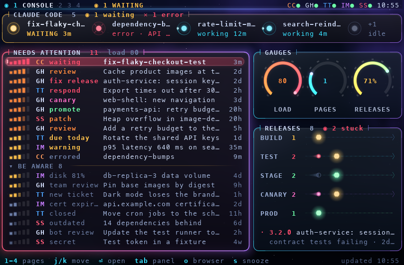
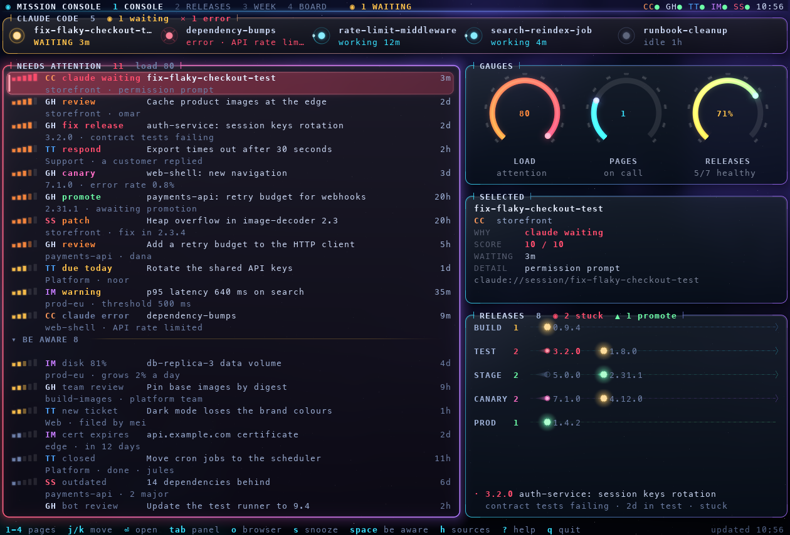
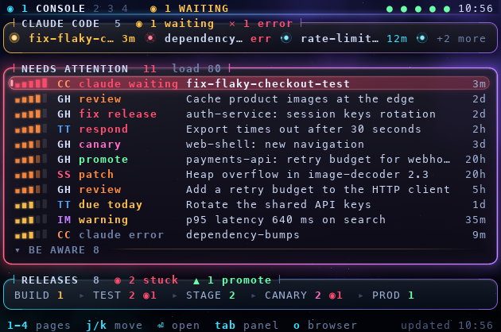
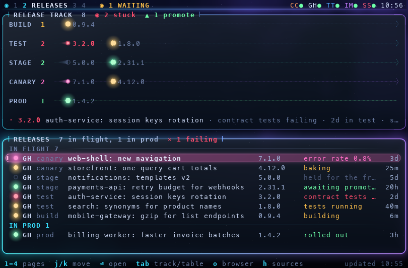
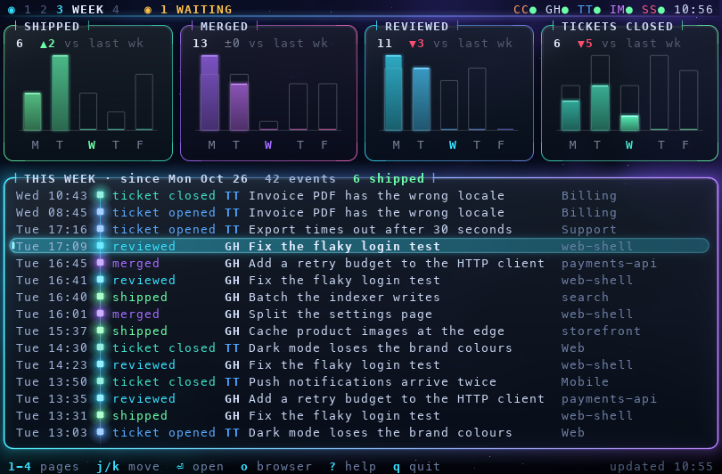
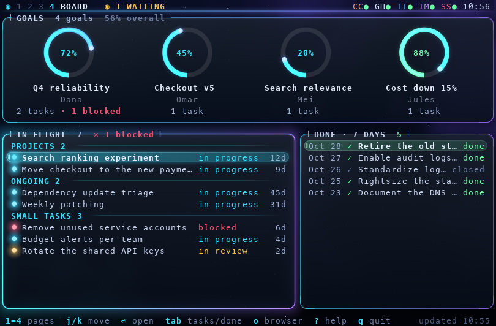
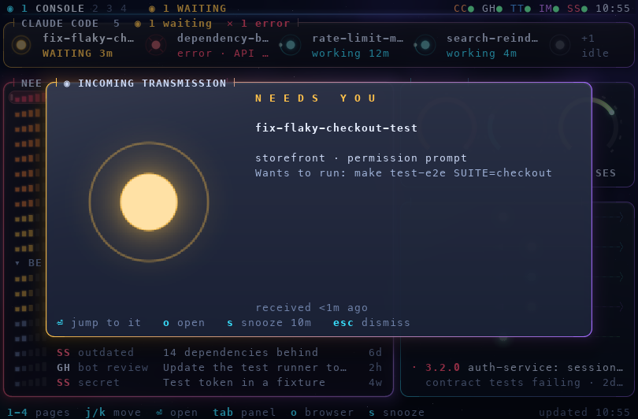
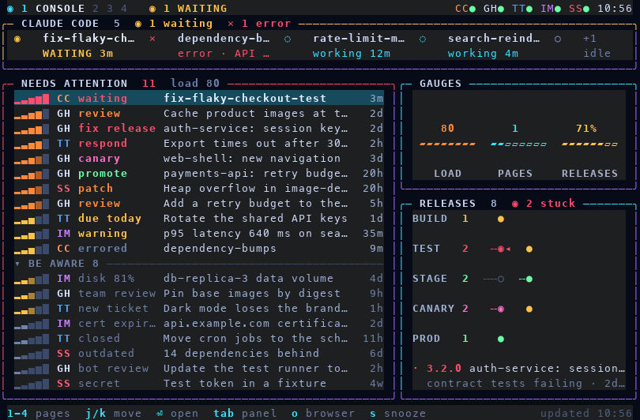
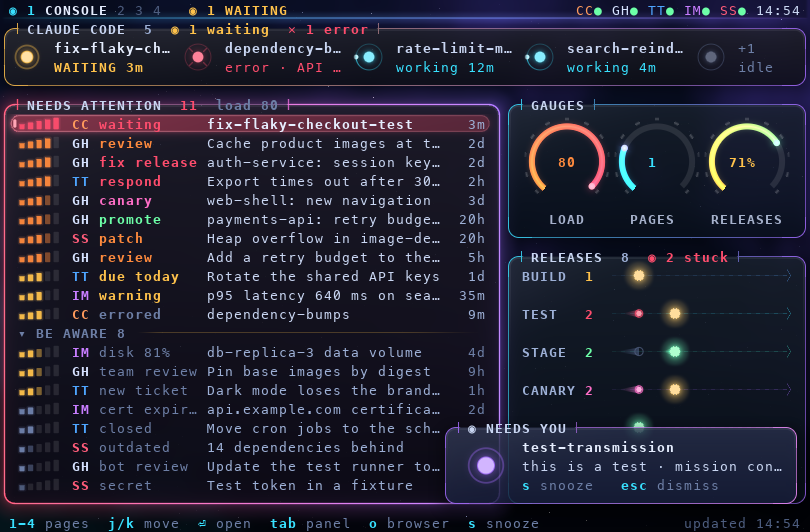

# textual-orbital

A library for always-on dashboards in [Textual](https://textual.textualize.io), built on [textual-glass](../textual-glass/README.md). You write one small `Source` per system you watch (a CI service, a ticket tracker, a monitor, Claude Code sessions). Orbital polls them in worker threads, merges their records into one snapshot, runs your alert rules, pops up "incoming transmissions", sends desktop notifications, and draws it all with dashboard widgets: status beacons, a priority queue with signal meters, items moving through stages on a track, task boards, timelines and gauges. With glass (Ghostty, kitty) the widgets get pixel glass, glowing meters and terminal-played animations; anywhere else they are a clean text TUI with the same layout.

It was built for a dashboard that stays open all day in a corner window, so it is:

- **useful at a glance:** every visual encodes something, and `?` shows the legend;
- **cheap while idle:** when nothing changes it sends nothing, and ambient motion is animation the terminal plays by itself (idle CPU measured at 0.12 %);
- **generic:** the records carry your own typed data, the rules are plug-ins, and stage names, event kinds and source keys are yours.



*Every image in this README is an **approximate composite**, drawn by the test harness from the app's real byte stream in a pty: pixels from a model of Ghostty's kitty rules, text in Menlo at 9x19 px cells. It is not a screenshot of Ghostty: no animation, no dim text, and the font and cell size differ from your terminal.*

## Install

It installs from GitHub, together with textual-glass. Name both packages in one command: pip can't resolve orbital's dependency on textual-glass by itself (uv can, but naming both works with either).

```sh
uv add "textual-glass[images] @ git+https://github.com/misterek/textual-glass#subdirectory=textual-glass" \
       "textual-orbital @ git+https://github.com/misterek/textual-glass#subdirectory=textual-orbital"
pip install "textual-glass[images] @ git+https://github.com/misterek/textual-glass#subdirectory=textual-glass" \
            "textual-orbital @ git+https://github.com/misterek/textual-glass#subdirectory=textual-orbital"
```

It needs Python 3.10 or later. The `images` extra (Pillow) is only needed for alert pictures loaded from files. Add `textual-glass[testing]` to your dev dependencies for the pty test harness.

From a local checkout (a clone at `../textual-glass`), name both too; the repository's [README](../README.md#install) says why, and how to keep `__pycache__/` out of the checkout:

```sh
uv add --editable "../textual-glass/textual-glass[images,testing]" ../textual-glass/textual-orbital
```

**Building a dashboard?** [`AGENTS.md`](AGENTS.md) walks through one from an empty project: a source, a rule, two pages, tests. The rules that keep it working in Ghostty are in [`../AGENTS.md`](../AGENTS.md).

## Try it

Mission Console (`examples/console/`) is a made-up team's dashboard over a scripted demo world with five sources: `CC` Claude Code, `GH` GitHub, `TT` TicketTracker, `IM` InfraMonitor and `SS` SecurityScanner. From the repository root, in Ghostty:

```sh
uv sync --all-packages
uv run python textual-orbital/examples/console/app.py
uv run python textual-orbital/examples/console/app.py --fake-speed 10    # every alert within seconds
uv run python textual-orbital/examples/console/app.py --plain            # text only, as in any terminal
uv run python textual-orbital/examples/console/app.py --alert-style toast    # alerts as corner toasts
```

| Option | What it does |
| --- | --- |
| `--fake-speed N` | Runs the demo script and the polls N times faster. |
| `--static` | Freezes the demo world after the first fetch. |
| `--plain` | Text only (`glass=False`). |
| `--no-alerts` | No popups. |
| `--alert-style modal\|toast` | Alerts as popups (the default) or as toasts in the bottom-right corner. "Claude needs you" stays a popup either way (`NeedsYouRule` in `rules.py` sets its `style`). |
| `--toast-timeout SECONDS` | How long a toast stays (default 8). |
| `--notify auto\|osc777\|osc9\|off` | Desktop notifications (default: by terminal). |
| `--alert-image PATH` | A picture or animated GIF for every alert (needs `images`). |
| `--snooze-file PATH` | Keep snoozes in this JSON file, so they survive a restart. |
| `--provider MODULE:FACTORY` | Real data instead of the demo: `FACTORY()` must return a provider. Turns on opening links in the browser. |

| Key | Action |
| --- | --- |
| `1` `2` `3` `4` | Console, Releases, Week, Board |
| `j` `k` / `↑` `↓` | Move in a list (`←` `→` between beacons or along a track lane) |
| `tab` | Next panel |
| `enter` | Details of the selected row; on an alert, jump to what it is about |
| `o` | Open the selected row's link (the demo only shows it) |
| `s` | Snooze the selected queue row for an hour; on an alert, snooze it for 10 minutes |
| `u` | Wake everything snoozed |
| `z` | What is snoozed, and when each item comes back |
| `space` | Fold the "be aware" list |
| `[` `]` | On the Week page: an older or newer week |
| `r` | Fetch every source now |
| `h` | Source health: why a dot is amber or red (a click on the dots works too) |
| `t` | A test alert (in the current style) |
| `m` | Alerts as popups or as toasts |
| `s` / `esc` while a toast shows | Snooze it for 10 minutes / dismiss it (a toast takes no keys of its own; a click jumps to what it is about) |
| `?` | Keys and the legend for every visual |
| `q` | Quit (deletes every image and clears the window title) |

The demo world replays a script, so every kind of alert shows up within the first two minutes (within seconds with `--fake-speed 10`):

| Time | What happens | Alert |
| --- | --- | --- |
| At start | a Claude Code session is already waiting at a permission prompt | "NEEDS YOU" |
| 25 s | a second session finishes a plan and waits for approval | "NEEDS YOU" |
| 45 s | the first session gets going again | (its alert, if still open, closes itself) |
| 50 s | the search release fails its tests | "ABORT · RELEASE FAILED" |
| 75 s | checkout's error rate pages the on-call | "INCIDENT · YOU ARE PAGED" |
| 100 s | a ticket is assigned to you | |
| 120 s to 150 s | the storefront release goes to production and lands | |
| 170 s | the security scanner fails for a while | a red health dot |
| 180 s on | random changes every 25 to 45 seconds | |

The rules behind the alerts: the library's `WaitingRule`, plus `ReleaseFailedRule` and `IncidentRule` in `examples/console/rules.py`.

### The pages

**1 · Console**, the default, built for a corner window. Claude Code beacons; the needs-attention queue; gauges (LOAD: the queue's load, PAGES: InfraMonitor items, RELEASES: the share of moving releases that are healthy); the release track. At 140x45 it adds a SELECTED card for the highlighted row; under 80 columns the side column folds into a one-line track summary.

| | |
| --- | --- |
|  |  |
| 140x45: two-line queue rows, the SELECTED card, bigger gauges | 70x22: one-line beacons, and the side column folds into a track summary |

**2 · Releases**: the big track with each release's version after its dot, and every release in a table, in flight and in production.



**3 · Week**: stat tiles (shipped, merged, reviewed, tickets closed, and incidents at 140 columns) with the week's total, the change against the same weekdays of last week and per-day bars with last week as outlines; then every event of the week on a timeline. `[` and `]` step to older and newer weeks: last week from the snapshot, older ones fetched on demand from the provider's `history(first, last)` (a "loading…" title while it runs).



**4 · Board**: goals as progress arcs with their task counts; tasks in flight grouped by list, with a meter for days in their status; tasks done in the last seven days.



| | |
| --- | --- |
|  |  |
| An alert over the dimmed console, with the drawn beacon | `--plain`: block meters, glyphs and a highlighted row |
|  | |
| `--alert-style toast`: a test alert as a toast in the corner, over the console that keeps the keys | |

## What every visual means

This is what the `?` legend (`textual_orbital.widgets.LEGEND`) and the widgets encode:

- **Header strip** (`HeaderStrip`):
  - the callsign and page tabs, the current one lit;
  - a `◉ N WAITING` badge while entities wait (the app sets it from `badge_changed`);
  - **source health**, one dot per source: green fresh, amber stale (no good fetch for three intervals, at least 30 s), a red `✕` when the last fetch failed or timed out (`h` shows why, and when it is tried next), hollow until the first fetch;
  - the clock, at minute resolution.
- **Beacons** (`BeaconRow`), one per `Entity`, most urgent first. Idle ones fold into a "+N" slot when space runs out.

  | State | Beacon (with glass) | Glyph | Text |
  | --- | --- | --- | --- |
  | waiting | bright amber core, pulsing, with rings | `◉` | `WAITING 3m · reason` |
  | error | red core, slow throb, a cross | `✕` | `error · reason` |
  | working | cyan core, a satellite on a slow orbit | `◌` | `working 12m` |
  | idle | dim dot in a faint ring, still | `○` | `idle 1h` |
  | done | green dot, still | `✓` | `done 5m` |
- **Queue** (`PriorityList`): needs-attention rows, then a foldable "be aware" section. Each row has:
  - a **signal-strength meter** for the 0-10 score, two points per bar, coloured by urgency: red 9+, orange 7+, amber 5+, slate 3+, grey;
  - the source badge (`SOURCE_COLORS`), the reason ("why", coloured by `WHY_COLORS`), the title and the age.

  The selection pill takes the row's urgency colour.
- **Track** (`Track`): items on one lane per stage, first stage at the top.
  - A dot's colour is its health: red failing, magenta needs work, amber pending, green clear, hollow grey parked.
  - Its comet trail is how long it has been in that stage, on a log scale where two weeks fills the slot (quantized, so it changes only every few hours).
  - A pulsing dot is stuck: failing, or more than `stuck_after_days` (default 2) in one stage. The pulse is played by the terminal.
  - Lanes are ordered oldest first; the count by each lane label takes the colour of its worst dot.
  - The caption describes the selected item. Below one row per stage the track becomes a one-line summary (`◉N` counts stuck items).
- **Track table** (`TrackTable`): a health dot, the source, the stage, the title, the label, the status (`detail`) and the age, in titled sections.
- **Task board** (`TaskBoard`): tasks grouped by list; the dot is the status colour (cyan in progress, amber in review, red blocked, teal ready); the meter is days in the current status, full at a month.
- **Timeline** (`EventLog`): events on a glowing spine, newest first, the dot coloured by kind.
- **Done list** (`DoneList`): finished tasks, newest first.
- **Gauges, arcs and tiles** come from textual-glass (`RingGauge`, `ProgressArc`, `StatTile`); the app decides what they measure. The theme has helpers for their colours: `load_color(f)` for "more is worse" (cyan, amber, red) and `health_gradient(f)` for "more is better" (red, amber, green).
- **Alerts**: a glass popup over the dimmed dashboard. Under any popup the dashboard's text goes faint, a scrim darkens its glass, and its beacons and pulses switch to a dimmed copy of themselves and pause. Or, with the toast style, a narrow glass panel in the bottom-right corner (the headline in its border, the beacon or picture, the title and first body line, "+N more") that leaves the dashboard bright and its keys free, and goes away after a few seconds.

## The data model

`textual_orbital.model` holds frozen, hashable dataclasses. Sources produce them; widgets only read them. Every timestamp is a timezone-aware `datetime` that says *when something started*; ages are computed at render time, so a record never changes just because time passed.

| Record | Fields (defaults after `=`) | Shown by |
| --- | --- | --- |
| `Entity` | `id, name, where="", state=EntityState.IDLE, since=None, reason="", detail="", url=None, data=None` | `BeaconRow`. Something that works on its own and sometimes needs you: a Claude Code session, a build agent, a job. `since` is when it entered `state`. |
| `EntityState` | `IDLE`, `WORKING`, `WAITING` (needs you), `ERROR`, `DONE` | |
| `AttentionItem` | `key, source, score, why, title, where="", detail="", since=None, section="attention", url=None, ref=None, data=None` | `PriorityList`. `score` is 0-10; `section="aware"` puts it in the be-aware list; `ref` links it to a record: `("entity", id)` or `("track", key)`. |
| `TrackItem` | `key, source, title, label="", stage=0, health=TrackHealth.OK, stage_since=None, opened_at=None, url=None, detail="", data=None` | `Track`, `TrackTable`. `stage` indexes the stage names you give the widget. `stuck(now, after=2 days)`: failing, or in one stage longer than `after` (`IDLE` never). |
| `TrackHealth` | `IDLE` (parked, never stuck), `PENDING`, `OK`, `WARN`, `FAIL` (always stuck) | |
| `Event` | `when, kind, source, title, where="", url=None, data=None` | `EventLog`, week stats. `kind` is your own word ("merged", "deployed"). |
| `Goal` | `id, name, owner="", progress=0.0, url=None, due=None` | `ProgressArc` (your page). |
| `Task` | `id, title, assignee="", status="in progress", group="", status_since=None, url=None, goal_id=None` | `TaskBoard`. |
| `DoneTask` | `id, title, done_at, status="done", url=None` | `DoneList`. |
| `SourceStatus` | `key, name, interval, last_ok, last_attempt, error, items, failures=0, next_poll=None`; `health(now)` | `SourceHealth`, `SourcesScreen`. Kept by the store. `items` counts every record of the last good fetch, events included; `failures` is failed attempts in a row (timeouts included); `next_poll` is when the next fetch is due (None while a source is paused on hung fetches). |
| `ErrorReport` | `at, where, message, count=1` | `SourcesScreen`. An exception the app caught and reported (`OrbitalApp.report_error`), kept in `app.errors`. |
| `Alert` | see [Rules and alerts](#rules-and-alerts) | `AlertScreen`. |

**Entities.** An `Entity` doesn't have to be shown by a `BeaconRow`: show it in a list or a card of your own, or not at all. Shown or not, entities in `WAITING` drive the `◉ N waiting` title badge (and `badge_changed`) and the shipped `WaitingRule`.

**Your own data.** `Entity`, `AttentionItem`, `TrackItem` and `Event` have `data: Hashable | None`. Put your own frozen record there (a pull request, a pipeline, a host). It takes part in equality, so a change in it is a content change. The library never looks inside it; read it back typed in your rules and views: `p = cast(Pipeline, item.data)`.

**Numbers for gauges.** A source reports plain numbers as named metrics: `SourceData(metrics={"disk": 0.42})`. They are merged in source order into `snapshot.metrics`, a read-only, hashable mapping, so give two sources' metrics distinct names (for a name both use, the later source wins). `snapshot.metric("disk")` reads one, or 0.0 (`default`) when no source reports it. A changed value is a content change, so round each value to what the screen shows; unrounded noise would redraw the dashboard on every fetch (rule 9 in [`../AGENTS.md`](../AGENTS.md)). A gauge fed from a source:

```python
import shutil

from textual.app import ComposeResult

from textual_glass import RingGauge
from textual_orbital import OrbitalApp, Page, Snapshot, SourceData, StaticProvider, load_color


class Disk:
    key, name, interval = "DK", "Disk", 60.0

    def fetch(self) -> SourceData:
        usage = shutil.disk_usage("/")
        return SourceData(metrics={"disk": round(usage.used / usage.total, 2)})  # whole percents, as shown


class DiskPage(Page):
    def compose(self) -> ComposeResult:
        yield RingGauge("DISK", id="disk")

    def update_snapshot(self, snapshot: Snapshot) -> None:
        used = snapshot.metric("disk")
        self.query_one("#disk", RingGauge).set(used, f"{used:.0%}", load_color(used))


class DiskBoard(OrbitalApp):
    def compose(self) -> ComposeResult:
        yield DiskPage()


if __name__ == "__main__":
    DiskBoard(StaticProvider([Disk()])).run()
```

`Snapshot` is everything merged from every source: `taken_at`; `entities, attention, track, events, goals, tasks, done, sources` (tuples; attention sorted by score, then age); and `metrics`. `taken_at` is when it was taken: the end of the fetch it was merged after, or the moment items were snoozed or woken or the date changed (see [The app](#the-app)). Widgets take their "now" from it. A snapshot has `needs_attention` and `be_aware`, lookups `entity(id)`, `track_item(key)`, `item(key)` and `metric(name, default=0.0)`, and `week(on=None)`: this week's `WeekStats`, counted from the events by `kind`, or with `on` (a `date`) the week that holds it:

- `start` is the week's Monday (a `date`). `days` (this week, from Monday) and `previous` (the same weekdays last week) are tuples of `DayCount(day, counts)`: the `date`, and a dict of event counts by kind.
- `total(kind)`, `previous_total(kind)` (last week over the same weekdays so far), `delta(kind)`, `series(kind)` and `previous_series(kind)` (one count per day), `events` (this week's, newest first) and `elapsed` (days so far, today included).
- This week runs Monday to Friday, or to today at the weekend. Another week (`on` in it) is counted whole, Monday to Sunday, against the whole week before it.
- `week(on)` counts only the snapshot's `events`, so the sources must report that week and the one before. For older weeks, fetch their events on demand with `OrbitalApp.fetch` and count them the same way: `replace(snapshot, events=fetched).week(on)` ([AGENTS.md](AGENTS.md#fetching-on-demand-a-past-week) has the pattern).

`queue_load(snapshot, snoozed)` returns the queue's load (the sum of unsnoozed needs-attention scores) and the load that fills a gauge (60).

## The source seam

```python
from textual_orbital import Entity, EntityState, SourceData, StaticProvider, now


class BuildAgents:
    key, name, interval = "BA", "Build agents", 10.0   # interval in seconds

    def fetch(self) -> SourceData:                       # runs in a worker thread; may block
        return SourceData(entities=[Entity("agent-1", "agent-1", "linux-pool", EntityState.WORKING, now())])


provider = StaticProvider([BuildAgents()])
```

- A **source** is any object with `key`, `name`, `interval` and `fetch() -> SourceData` (the `Source` protocol; no base class). Each fetch runs in a daemon thread of its own, so it may block on a subprocess or HTTP. The `key` is the source's badge: queues and tables show two characters of it (`EventLog` three), so `"GIT"` shows as `GI`.
- **`fetch()` must set its own timeouts** on every network call and subprocess (`timeout=` on `subprocess.run` and on HTTP requests). A thread can't be stopped: a call with no timeout whose socket died while the laptop slept keeps its thread for good.
- **Deadline.** A source may have a `timeout` attribute in seconds; without one it is `max(2 * interval, 10)` (`fetch_timeout(source)`). A fetch past its deadline turns the source red ("timed out after 20 s"), and its late result is ignored. A source with `OrbitalApp.HUNG_LIMIT` (2) such fetches still running stops polling until one returns, and says so in its error. So a new fetch may start while a hung one is still blocked: keep `fetch()` safe to run twice at once.
- **Schedule.** The next fetch starts `interval` seconds after the last one ended. While a source fails (timeouts included), the wait doubles with each failure in a row, up to 15 minutes (or `interval`, if longer), and a good fetch resets it: `poll_delay(interval, failures)`. `app.poll_all()` fetches every source now, whatever the wait. The status's `next_poll` says when.
- **`SourceData(entities, attention, track, events, goals, tasks, done, metrics)`**: each field you set *replaces* that source's previous value for that field. `None` means "this source doesn't report this", and `[]` (`{}` for `metrics`) means "it reports none". Sources never see each other's data; the store concatenates them (and merges the metrics).
- **Errors:** raise. The source turns red, the first line of the exception is the reason on `h`, and its last good data stays on screen. Anything raised counts, `SystemExit` included (`"SystemExit: 2"`).
- **Keys are unique across sources** (attention and track `key`, entity `id`): snoozes, `item()` and jumps use the bare key. Prefix them with the source key (`"GH:412"`). A fetch with a key that another source's current data already has fails, as "duplicate key '412' (also from GH): prefix keys with the source".
- **Timestamps are timezone-aware.** A fetch with a naive `datetime` in any record fails, as "naive datetime in AttentionItem.since"; nothing is coerced. (Your own record in `data` is not checked.)
- A **provider** is anything with `sources()`; `StaticProvider(sources)` is a list.
- **`Store`** keeps each source's latest data and merges it into a `Snapshot`. Its `content_version` changes only when the merged content changes (a metric's value included), so a fetch that returns equal data costs nothing downstream. `apply(key, data, at, fetch_ms)` returns False when it failed the source instead (a naive datetime or a duplicate key); `fail(key, error, at)`, `schedule(key, at)`, `status(key)` and `statuses()` keep the statuses.
- **`timed_fetch(source)`** runs one fetch and returns `(data, error, milliseconds)`: test a source without the UI.

The rules for writing real sources (stable keys, "since" timestamps, `stage_since`) are in [`AGENTS.md`](AGENTS.md#wiring-real-sources).

## The app

`OrbitalApp(Glass, App)` polls a provider and keeps `self.snapshot` current. Subclass it and compose your pages from the widgets.

```text
OrbitalApp(provider, *, rules=(WaitingRule(),), alert_images=None, alerts=True, alert_style="modal",
           toast_timeout=8.0, notify="auto", bell=True, title_badge=True, open_urls=False, open_hosts=None,
           snooze_file=None, **kwargs)   # other keywords go to Glass and App
```

| Argument | Meaning |
| --- | --- |
| `provider` | Where the data comes from. |
| `rules` | The alert rules (below). |
| `alert_images` | A picture or GIF per alert kind (paths), e.g. `{"waiting": "~/art.gif"}`; decoded in a thread. |
| `alerts` | Raise popups. |
| `alert_style` | How alerts show: `"modal"`, a popup that takes the keyboard, or `"toast"`, a corner toast that takes no keys and goes away after `toast_timeout` seconds (a timeout counts as dismissed). An alert's own `style` wins, so a rule can keep its alerts popups while the rest toast. Change it at run time with `app.alert_style = "toast"`. |
| `toast_timeout` | Seconds a toast stays (8). |
| `notify` | Desktop notifications: `"auto"`, `"osc777"`, `"osc9"` or `"off"`. |
| `bell` | Ring the bell with each notified alert. |
| `title_badge` | Put "◉ 2 waiting · Title" in the window title. |
| `open_urls` | `open_link` opens the browser, in a thread (it shells out on macOS). The default `False` only shows the link: pass `True` in your real dashboard's `main()`, never in tests (rule 20 in [`../AGENTS.md`](../AGENTS.md)). |
| `open_hosts` | With `open_urls`, the hosts `open_link` may open, e.g. `{"github.com"}` (exact names, any case); a link to another host is only shown. None (the default) means any http or https link. |
| `snooze_file` | A JSON file (a path; `~` works) that keeps item and alert snoozes across restarts, each with when it ends. It is read when the app mounts, before the first fetch, and snoozes that ended while the app was closed are dropped; a file that can't be read or parsed is reported (`report_error`) and treated as empty, never stopping startup. It is written after every change, to a temporary file then `os.replace`, so it is never half written; its directory is made if needed. None (the default) keeps snoozes in memory. |

It registers the `ORBITAL` and `ORBITAL_NAVY` themes and selects `orbital`. It defines **no key bindings**: your app binds its own keys to its actions and to the methods below.

| Hook (override) | Called | Default |
| --- | --- | --- |
| `snapshot_changed(snapshot)` | the merged content changed; items were snoozed, woken or came back by themselves; or the date changed (on the minute tick, so `week()` rolls over on Monday). The last three pass the same content taken now. | `update_snapshot(snapshot)` on every widget that has it (your `Page`s); one that raises is reported and the others still get it |
| `health_changed(statuses, at)` | a source went fresh, stale or failing | `set_statuses(statuses, at)` on every widget that has it (`SourceHealth`) |
| `minute_tick(at)` | every minute boundary | `minute_tick(at)` on every widget that has it, on every screen: each `Page` (which ticks its own widgets) and the header's `Clock`. |
| `badge_changed(text, waiting)` | the attention badge changed ("◉ 2 waiting", or None) | nothing (pass `text` to `Brand.set_badge` here) |
| `show_detail(record)` | `jump_to` found the record an alert points at | nothing (push a `DetailScreen` here) |
| `alert_beacon(alert)` | an alert without a picture is shown | `"waiting"`: the drawn beacon's state |

| Method or attribute | What it does |
| --- | --- |
| `snapshot`, `store` | `snapshot` is the latest `Snapshot` (None until the first fetch). Every fetch replaces it, taken at that fetch's end, even when the content is unchanged (then `snapshot_changed` doesn't run). `store` is the `Store` (`store.statuses()`). |
| `poll_all()` | Fetch every source now, including those waiting out a backoff. |
| `report_error(where, error)`, `errors` | Report an exception caught on the app thread: logged with its traceback (the `textual_orbital` logger), kept in `errors` (the last `ERRORS_KEPT`, 20, oldest first; the same error once, with a count) and shown in a toast at most every `ERROR_TOAST_SPACING` (30) seconds. The app reports what its hooks, rules, pages and thread callbacks raise; call it for your own. Show `errors` with `SourcesScreen(statuses, errors=app.errors)`. |
| `snooze_item(key, duration=None)`, `unsnooze(key)`, `wake_items()`, `visible_items(items)` | Hide an attention item for `ITEM_SNOOZE` (an hour); bring one back (False if it wasn't snoozed) or all of them (returns how many); filter a list. Pages filter with `Page.snoozed()`. |
| `snoozed`, `alert_queue.snoozed` | What is snoozed: attention item keys, and alert keys, each mapped to when it comes back. With `snooze_file`, both survive a restart, and a snoozed alert raised again at startup (a `WaitingRule` alert, say) stays quiet until its snooze ends. |
| `fetch(func, *args, then, timeout=30.0)` | Run `func(*args)` once, in a daemon thread of its own with a deadline, and call `then(data, error)` on the app thread, in its context: `(result, None)`, or `(None, exception)` when `func` raised (anything, `SystemExit` included) or ran past `timeout` seconds (a `TimeoutError`; the late result is dropped). What `then` raises goes to `report_error`. The one way to fetch something with parameters on demand: a past week, a record's comments. `func` sets its own network and subprocess timeouts (rule 21), and `then` checks that its result is still wanted. |
| `raise_alert(alert)` | Queue a one-off alert (deduplicated by key). |
| `alert_view`, `finish_alert(action="dismiss")` | The alert on screen, its `AlertScreen` or its `AlertToast` (None when there is none). `finish_alert` acts on it as the popup's keys do, with `"jump"`, `"open"`, `"snooze"` or `"dismiss"`: bind your own keys to it for toasts, which take none (the console binds `s` and `esc` while a toast shows). A popup is acted on only while it is on top; returns False when there is nothing to act on. |
| `jump_to(target)` | Find the record an `("entity", id)`, `("track", key)` or `("item", key)` target names and call `show_detail`. |
| `open_link(url)` | Open in the browser (with `open_urls`), or show the link. |
| `call_from_worker(callback, *args)` | Run a callback on the app thread, in the app's context, from any thread (rule 13). What it raises goes to `report_error`. |
| `alert_queue`, `alert_rules`, `notifier` | The `AlertQueue`, the `AlertRules`, the `Notifier`. |
| `HORIZONTAL_BREAKPOINTS`, `VERTICAL_BREAKPOINTS` | Classes set on every screen: `-narrow` (under 80 columns), `-compact` (80-111), `-regular` (112-139), `-wide` (140+); `-short` (under 25 rows), `-mid` (25-37), `-tall` (38+). Write `Screen.-narrow #side { display: none; }` in your CSS. |
| `ALERT_SNOOZE`, `ITEM_SNOOZE`, `ALERT_SCREEN`, `ALERT_TOAST` | 10 minutes, an hour, the popup class and the toast class. |
| `HUNG_LIMIT`, `ERRORS_KEPT`, `ERROR_TOAST_SPACING` | Fetches of one source that may hang past their deadline before it pauses (2); error reports kept (20); seconds between error toasts (30). |

`OrbitalApp`'s default CSS gives every `GlassPanel` a border from the theme's primary colour (left, top) to its secondary colour (right, bottom); your CSS and `GlassPanel.set_accent` override it.

## Rules and alerts

An **alert** is an "incoming transmission": a big popup that wants you now, or a toast in the corner that you can let go by (`alert_style`).

| `Alert` field | Meaning |
| --- | --- |
| `key` | Dedupe key: an alert with the same key is not raised again while it is showing, queued or snoozed. |
| `kind` | Your name for the kind ("waiting", "pipeline failed"); picks the picture from `alert_images`. |
| `title`, `body` | The big line, and the lines under it. |
| `headline` | The small line over the title (default "INCOMING TRANSMISSION"). |
| `priority` | Higher shows first (`WaitingRule` uses 100). |
| `color` | Accent colour (hex), or None for violet. |
| `image` | A picture path, or None for the drawn beacon. |
| `url` | What `o` opens from the popup. |
| `target` | What `enter` jumps to: `("entity", id)`, `("track", key)`, `("item", key)` or None. |
| `notify` | Also send a desktop notification, ring the bell and badge the title (default True). |
| `raised_at`, `from_rule` | Set by the queue and by `AlertRules`. |
| `style` | `"modal"` or `"toast"` (`ALERT_STYLES`), or None (the default) for the app's `alert_style`. Anything else raises `ValueError`. |

A **rule** is any object with `conditions(snapshot)`, yielding a `Condition(key, source, alert)` for every alert-worthy situation that holds right now:

```python
from collections.abc import Iterator

from textual_orbital import Alert, Condition, Snapshot, TrackHealth


class FailingRule:
    def conditions(self, snapshot: Snapshot) -> Iterator[Condition]:
        for t in snapshot.track:
            if t.health is TrackHealth.FAIL:
                key = f"failing:{t.key}:{t.stage_since}"   # a new failure is "new again"
                yield Condition(key, t.source, Alert(key=key, kind="failing", title=t.title,
                                                     headline="FAILED", priority=80, color="#ff4d6d",
                                                     url=t.url, target=("track", t.key)))
```

`AlertRules(rules, images=None, startup_kinds=frozenset({"waiting"}))` turns conditions into alerts. `OrbitalApp` runs it after every fetch of any source, whether the data changed, stayed the same or the fetch failed, on a fresh snapshot whose `taken_at` is that fetch's time. It doesn't run on the minute tick, so a rule about time ("waiting for more than 10 minutes") is as prompt as your shortest source interval.

- An alert is raised when a condition's key first appears.
- Conditions that already hold the first time their `source` is fetched are a baseline, not news, and don't alert; the exception is kinds in `startup_kinds`.
- When a condition goes away, its queued or snoozed alert is dropped, and an open popup closes itself. When it comes back, it alerts again.
- So the key must change when the situation is "new again", and only then: `WaitingRule` puts the entity's `since` in it.

The library ships **`WaitingRule(source="CC")`**: an `Entity` entered `WAITING`. Kind `"waiting"`, headline "NEEDS YOU", priority 100, amber, body from `where`, `reason` and `detail`, target the entity. Pass your entities' source key if it isn't `CC`.

> **`since` must be stable.** It must be when the entity *entered* `WAITING`, the same on every fetch while it waits. A source that sets `since=now()` on every fetch makes every poll a new wait, so the same popup comes back every few seconds. When the API has no such timestamp, keep the first time you saw the wait in the source, keyed by the entity's id (as `PipelineSource` does for stages in [`AGENTS.md`](AGENTS.md#2-the-data-and-the-source)).

The **queue** (`AlertQueue`) shows one alert at a time, highest priority first. Its `snoozed` maps snoozed alerts' keys to when they come back; `restore(snoozed)` snoozes keys before their alerts are raised (what `snooze_file` does at startup), and a restored alert that no rule raises again just ends with its snooze. In the popup (`AlertScreen`), `enter` jumps to the target, `o` opens the link, `s` snoozes it for `ALERT_SNOOZE` (it comes back if still relevant) and `esc` dismisses it. A toast (`AlertToast`) shows the same alert in the bottom-right corner of the screen on top, takes neither focus nor keys, and is dismissed when its `toast_timeout` runs out; a click on it jumps to the target, and your own keys act on it through `finish_alert`. It moves to a popup that opens over the dashboard, and back when that closes, keeping the time it had left. Either way the queue works the same: one alert at a time, snoozes, and an alert whose condition goes away closes itself. For a one-off, call `app.raise_alert(Alert(key=..., kind=..., title=...))`; a popup stays until dismissed.

A rule that keeps its alerts popups while the app's style is `"toast"` sets their `style` (the console's `NeedsYouRule`, in `examples/console/rules.py`):

```python
from collections.abc import Iterator
from dataclasses import replace

from textual_orbital import Condition, Snapshot, WaitingRule


class NeedsYouRule(WaitingRule):
    def conditions(self, snapshot: Snapshot) -> Iterator[Condition]:
        for cond in super().conditions(snapshot):
            yield replace(cond, alert=replace(cond.alert, style="modal"))
```

## Notifications in Ghostty

Each alert with `notify=True` can also send a desktop notification, ring the bell and badge the window title (`textual_orbital.notify.Notifier`):

- `notify="auto"` picks OSC 777 for Ghostty, OSC 9 for iTerm2, WezTerm and kitty, and nothing under screen or in other terminals (under tmux, see below). `TEXTUAL_ORBITAL_NOTIFY=osc777|osc9|off` overrides the guess.
- The notification's title is the app's title, a colon and the alert's headline in sentence case (`str.capitalize`: the first letter upper case, the rest lower case), for example "Machine Deck: Disk almost full" for `headline="DISK ALMOST FULL"`. Its body is the alert's title and first body line. Notifications are spaced at least 1.2 s apart.
- The title badge is "◉ N waiting · App title" while entities wait, or "◉ N alerts" while alerts are queued.
- **Under tmux**, notifications go out wrapped in tmux's DCS passthrough (`ESC P tmux; ... ESC \`), which tmux 3.3 and later forward only with `set -g allow-passthrough on` in `tmux.conf`. In `auto` mode the outer terminal is guessed from the variables tmux keeps (`GHOSTTY_RESOURCES_DIR` for Ghostty, `KITTY_WINDOW_ID`...); set `TEXTUAL_ORBITAL_NOTIFY` if the guess is off. The bell and the title badge are left to tmux. GNU screen gets no notifications.

What Ghostty 1.4 does with those, checked in its source at tag `v1.4.0`:

| Signal | What Ghostty does |
| --- | --- |
| OSC 777 (`notify;title;body`) and OSC 9 | Both become desktop notifications, unless `desktop-notifications = false`. Ghostty sends at most one a second and drops an identical one within five seconds. On macOS the first one asks for notification permission. |
| Kitty's OSC 99 | Parsed but not acted on, so it is not used. |
| BEL | With the default `bell-features`, an unfocused window bounces its dock icon once and gets a 🔔 in its title. |
| Title push and pop | Not implemented, so on exit orbital clears the title. Ghostty treats an empty title as "never set" and shows your working directory or its default title again. |

## Themes

The Orbital look is a Textual theme. `OrbitalApp` registers both presets and selects `ORBITAL`:

| Theme | Name | Look |
| --- | --- | --- |
| `ORBITAL` (default) | `orbital` | Deep space with dim violet and teal nebulae and stars, cyan and violet accents. |
| `ORBITAL_NAVY` | `orbital-navy` | The same colours without the nebulae: dark navy and stars. |

Switch with `app.theme = "orbital-navy"` (or the command palette's "Change theme"). The presets set glass's theme variables (`glass-backdrop: nebula`, `glass-scrim-alpha: 0.62`, the nebula colours and strength); see [textual-glass's AGENTS.md](../textual-glass/AGENTS.md#theme-variables-glass-reads). Any Glass app can use them with `register_theme(ORBITAL)`, and an orbital app keeps working under a stock Textual theme, although its widgets' text keeps the Orbital colours.

`textual_orbital.theme` (all exported from `textual_orbital`) also has:

| Name | What it is |
| --- | --- |
| `PALETTE` | Every Orbital colour as a hex string (`accent`, `accent_2`, `text_bright` to `text_ghost`, `green`, `amber`, `orange`, `red`, `magenta`, `violet`, `blue`, `teal`, `slate`, `grey`...). Widgets read it when they render. |
| `SOURCE_COLORS`, `SOURCE_NAMES` | Badge colours and names by source key (`CC` Claude Code, `GH` GitHub); other keys get a neutral colour and their key. Add yours: `SOURCE_COLORS["CI"] = "#4ea5ff"`. |
| `WHY_COLORS` | Colours for queue "why" words ("respond", "review", "unblock", "land it"...); other words are dim. Add yours the same way. |
| `urgency_color(score)`, `source_color(key)`, `why_color(why)` | The colours the widgets use. |
| `load_color(fraction)`, `health_gradient(fraction)` | Two-stop gradients for gauges: more is worse, more is better. |
| `fmt_age(delta)` | An age at minute resolution: `<1m`, `3m`, `5h`, `2d`, `6w`. Use it for every age (rule 9). |
| `fmt_interval(seconds)`, `ellipsize(text, width)`, `now()` | `10s`/`1m`; cut with `…`; timezone-aware now. |

## Widgets

`textual_orbital.widgets` (also exported from `textual_orbital`). Every widget works with and without glass, takes plain records, and takes `id` and `classes`. Widgets with `tick(at)` re-render their ages when their `Page` gets the minute tick.

| Widget | Constructor | Update it with | Notes |
| --- | --- | --- | --- |
| `HeaderStrip` | `HeaderStrip(callsign="ORBITAL", pages=(), *, id=None)` | its parts: `.brand`, `.health`, `.clock` | One row: brand and tabs, source health, clock, over a band with a glowing hairline. `health` gets `set_statuses` from the app by default. |
| `Brand` | `Brand(callsign="ORBITAL", pages=(), *, id=None)` | `set_page(index)`, `set_badge(text, color=amber)` | Shortens itself to fit. The badge gets a `◉` in front unless its text starts with one, so `badge_changed`'s text can go straight in. |
| `SourceHealth` | `SourceHealth()` | `set_statuses(statuses, at=None)`, `set_compact(bool)` | Posts `SourceHealth.Clicked`. Drops the keys below `HeaderStrip.COMPACT_BELOW` (84) columns. |
| `Clock` | `Clock()` | `tick()` | `HH:MM`. |
| `KeyBar` | `KeyBar(keys=(), *, id=None)` | `set_keys([(key, label)])`, `set_status([(text, style)])` | Docked at the bottom; drops hints from the right as space runs out, status on the right. |
| `Page` | subclass it | `update_snapshot(snapshot)` (override), `minute_tick(at)`, `focus_default()`, `snoozed()` | A `Vertical` for one page. Class attributes `KEYS` (the key bar's hints) and `DEFAULT_FOCUS` (a selector). |
| `BeaconRow` | `BeaconRow(*, empty="nothing running")` | `set_entities(entities, at=None)`, `tick(at)`, `highlighted` | Two lines per beacon at height 2, one at height 1. Keys `←` `→` (also `j` `k` `↑` `↓`), `enter`. Posts `BeaconRow.Selected(entity)`. |
| `PriorityList` | `PriorityList(*, two_line=None)` | `set_items(attention, aware=(), at=None)`, `tick(at)` | A `SelectList`: `SelectList.Highlighted`/`Selected` carry the `AttentionItem` in `.row`. `space` or `a` folds the be-aware section. Two lines per row (the second: `where` and `detail`) when `two_line`; with None, when the list is at least 60 wide and either 30 rows tall or tall enough for every row, section headers included, on two lines. For any other rule, override the `row_lines` property (1 or 2). After each `set_items` it posts `PriorityList.RowsLeft` with `.items`: the items whose key is in neither section any more (snoozed, resolved, gone from their source), for an exit effect ([AGENTS.md](AGENTS.md#an-exit-effect-for-rows-that-leave-the-queue)). |
| `Track` | `Track(stages, *, stuck_after_days=2.0, labels=None, label_width=5, colors=None)` | `set_items(items, at=None)`, `tick(at)`, `select_key(key)`, `selected`, `is_stuck(item)` | Keys `←` `→` along a lane, `↑` `↓` (`k` `j`) between lanes, `enter`. Posts `Track.Selected(item)`. An item's `stage` past the end goes in the last lane. `labels` writes `label_width` characters of each item's `label` after its dot from 50 columns wide (None or True; False never). Lanes start after the stage names (the longest plus 3 cells; under 28 columns, 3 letters of each in 4 cells) and hold one dot per slot of 4 cells (`label_width + 4` with labels); a lane with more items shows `+N` in its last slot, and `←` `→` skip the hidden ones. The caption under the lanes is the selected item's label and name, then `caption_tail(item)` (status, time in stage, "stuck"): the name keeps its room and the tail is cut first, down to `CAPTION_TAIL_MIN` (10) characters, so keep an overridden tail short. Override `dot_label(item)` to change the text after a dot. |
| `TrackTable` | `TrackTable(stages)` | `set_items(items, at=None)`, `set_groups([(label, items)], at=None)`, `tick(at)` | A `SelectList` of `TrackItem`s; empty groups are left out. |
| `TaskBoard` | `TaskBoard()` | `set_tasks(tasks, groups=(), at=None)`, `tick(at)` | A `SelectList`; `groups` come first, in that order, then the rest by name. |
| `EventLog` | `EventLog(*, colors=None)` | `set_rows(events)` | A `SelectList` of `Event`s; `colors` maps kinds to colours (other kinds get a stable colour of their own; `kind_color(kind)`). |
| `DoneList` | `DoneList()` | `set_rows(done_tasks)` | A `SelectList` of `DoneTask`s. |
| `AlertScreen` | `AlertScreen(alert, image=None, queued=0, beacon="waiting")` | `close_resolved()`, `set_queued(n)` | Dismisses with `"jump"`, `"open"`, `"snooze"` or `"dismiss"`, or `"resolved"` when the app closes it because its condition went away (now if it is on top, else once it is on top again); its hint line offers `o` only when the alert has a `url`. `OrbitalApp` shows it for you. |
| `AlertToast` | `AlertToast(alert, image=None, queued=0, beacon="waiting", timeout=8.0, done=None)` | `close_resolved()`, `set_queued(n)`, `finish(action)`, `remaining()`, `place(width=None)` | A `GlassPanel` docked at the bottom right of its screen (40 columns by 5 rows; 36 under 80 columns, 52 from 140), one row above the bottom, on a layer of its own (it takes no room from the page) with `overlay: screen` (glass draws it on the float layer). The headline in its border, the picture or beacon, the title, the first body line, "+N more" and `HINTS`, the class attribute for the keys your app binds (empty by default). It takes no focus or keys; it calls `done(action)` once: `"timeout"`, `"jump"` (a click), `"resolved"`, whatever `finish` gets, or `"dismiss"` if it is removed some other way. `OrbitalApp` shows and moves it for you. |
| `DetailScreen` | `DetailScreen(title, subtitle="", fields=(), body="", visual=None, url=None, accent=..., kind="DETAIL")` | | A large popup: `fields` are `(label, value)` pairs, `visual` any widget (hidden when narrow). Dismisses with `"open"` (`o`) or None (`esc`): `push_screen(screen, callback)` and call `open_link` on `"open"`. A field's value, or `body`, may be a zero-argument callable for a slow lookup (linked pull requests, comments): when the popup opens it runs through `OrbitalApp.fetch` (a daemon thread, a deadline of `LOAD_TIMEOUT`, 10 s), `LOADING` ("loading…") shows until it returns, and an error or the deadline shows in its place and goes to `report_error`. A value that comes back after the popup closed is dropped. |
| `HelpScreen` | `HelpScreen(keys, legend=LEGEND)` | | Your keys as `(key, what)` pairs, and the legend as `(glyph, colour, meaning)` rows. From 80 columns the dialog is 86 wide: a key line fits a key of up to 7 characters and 23 of `what`, a legend line up to 5 characters of glyphs and 43 of meaning. Under 80 columns `what` gets 17 and the legend what is left (31 at 70 columns). Longer lines wrap. |
| `SourcesScreen` | `SourcesScreen(statuses, at=None, errors=())` | | Every source's health, last good fetch, interval, item count and error, with the failures in a row and the next try; then the newest `ERRORS_SHOWN` (5) of `errors`. Pass `app.store.statuses()` and `app.errors`. |
| `OrbitalModal` | subclass it | | The popups' base: centred, with a `.dialog-hint` line docked at the bottom. |

Helpers: `beacon_view(state, colour, glyph="◉")` (a big beacon as a `SpriteView`, for a detail view), `hint(("esc", "close"), ...)` (key hints as Rich text), `state_text(entity, at)`, `status_word(item)`, `order_entities(entities)`, `signal_glyphs(score, colour)`, `task_color(status)`, and the colour tables `STATE_COLORS`, `STATE_GLYPHS`, `HEALTH_COLORS` (track health), `HEALTH_WORDS`, `TASK_COLORS`. The generic instruments (`GlassPanel`, `RingGauge`, `ProgressArc`, `StatTile`, `InfoCard`, `SelectList`...) come from `textual_glass`.

## Costs

Measured on Mission Console with `--static --notify off`, in a real pty through `textual_glass.testing.harness` (9x19 px cells), counting the bytes written between steps:

| Situation | 90x28 | 140x45 |
| --- | --- | --- |
| Idle, data unchanged (Claude Code polled every 10 s), 8 s | **0 bytes**; CPU **0.12 %** (0.01 s, the resolution of `ps`) | 0 bytes; CPU under 0.12 % |
| Once a minute | 5 KB of text (ages, timers, the clock); no pixels | |
| Moving the queue's selection: the pill slides in about 10 in-place edits | 119 KB | 198 KB |
| Switching to a page for the first time: a half-resolution backdrop in the same frame as the text, then the full one from a worker thread | 406 to 444 KB of pixels | 663 to 772 KB |
| Switching to a page seen before: its backdrop is placed again (up to four are kept) | 0.1 KB of pixels, 15 to 21 KB of text | 0.1 KB, 25 to 37 KB of text |
| The help popup opens / closes: a scrim and a dialog layer; beacons switch to their dimmed frame | 54 / 13 KB of pixels | 62 / 18 KB |
| An alert with the drawn beacon (uploaded once, reused) | 290 KB of pixels | 630 KB |

The backdrop is capped at 2.4 megapixels; on large Retina windows the terminal scales it up.

## Tests

From the repository root:

```sh
uv run pytest textual-orbital/tests                    # about two minutes; test_pty.py is the slow part
uv run python textual-orbital/tests/test_pty.py --png /tmp/orbital-steps   # also write a composite per step
uv run python textual-orbital/tests/screenshots.py     # regenerate docs/screenshots (approximations)
```

| File | Checks |
| --- | --- |
| `tests/test_units.py` | Source health, week stats (this week and a past week whole), stuck items, `data` in equality, snapshot lookups, `queue_load`, the store's merging and versioning (metrics included), its rejection of naive datetimes and duplicate keys, item and failure counts, rules running after every fetch on a re-stamped snapshot, `timed_fetch` errors (`BaseException` included), `poll_delay` and `fetch_timeout`, the alert queue (order, dedupe, snooze, resolve, snoozes restored from a file), rules alerting on transitions and not on the baseline, `WaitingRule`, custom rules, notification escapes, spacing and tmux passthrough, the bounded `sent` log, the title badge, theme helpers and presets, minute-resolution ages, the demo world's script and churn, and no shadowed Textual attributes. |
| `tests/test_app.py` | `OrbitalApp` headless over fake sources: fetch deadlines, late results ignored, the hung limit, `SystemExit` in a fetch, a fetch thread that dies, the poll schedule from the end of a fetch, `fetch` (a thread, its deadline, a late result dropped, errors handed back, `then` in the app's context), backoff and `poll_all`, error reports from steps, pages, rules, thread callbacks and the snapshot (with the toast throttle), closing a resolved alert under another popup or twice, lazy detail values (placeholders, errors and deadlines in place, dropped after the popup closed), toasts moving off a closing popup and telling the app however they go, `finish_alert` leaving a covered popup alone, alert styles checked, snapshots re-stamped by snoozing and on a new day, snoozes kept in a file across a restart (no popup at launch for a snoozed wait, ended ones dropped, broken files reported and never fatal, atomic writes), the minute tick re-arming, opening links off the UI thread with `open_hosts`, and the health screen's next try and errors. |
| `tests/test_pilot.py` | Mission Console with glass forced on: the scene, idle silence, partial edits for cursor moves, every page, beacon sprites, alert layers and dimming, the queue's snooze and resolve, alerts following the demo dynamics, snoozing a row and listing what is snoozed, stepping through past weeks (held and fetched), a release's run log loaded lazily in its detail, toast alerts (popups kept for Claude, one toast at a time with "+N more", the float layer, no focus or keys, snooze and dismiss, timeouts, resolving, a click to jump, moving over a popup and back, without glass), detail, help and sources popups, the breakpoints at three sizes, the plain fallback, ages, sprites dimming under popups, page switches in the same frame, alert pictures loaded on demand, the widgets with another app's stages and event kinds, two-line queue rows, the queue's `RowsLeft`, the track's caption, the brand's badge, the alert's hint line, the key bar's "updated" time (the last good fetch), and no error reports. |
| `tests/test_pty.py` | The console in a real pty, replayed through pyte and the kitty model: protocol hygiene, layers, every cell background default (also under popups, placeholders included), zero idle traffic, idle CPU under 2 %, every page's panels, the alert's scrim, dialog and picture, a resize, three window sizes, a toast's float image placed and deleted, every alert kind with OSC 777 notifications, notifications through tmux passthrough, quitting with a hung fetch (`tests/hung_app.py`), and the fallbacks (`--plain`, `TEXTUAL_GLASS=off`, a terminal that never answers). |
| `tests/test_version.py` | `__version__` matches `pyproject.toml`. |
| `tests/conftest.py` | The `output` fixture; `no_browser`, an autouse fixture that replaces `webbrowser.open` so no test can open the real browser; and `outside_tmux`, which clears `TMUX` and `STY` so the suite runs the same from a shell inside tmux. |

## Limitations

- **Only tested headlessly.** The tests check the byte stream against the protocol and against Ghostty's source, not real pixels. The final check is a person looking at Ghostty.
- **Built for dark themes.** The widgets draw text in `PALETTE` colours. Under a light theme, glass's chrome follows the theme but the widgets' text doesn't.
- **Process-wide colour tables.** `PALETTE`, `SOURCE_COLORS`, `SOURCE_NAMES` and `WHY_COLORS` are module-level dicts; apps add to them at import time.
- **Notifications** were checked only against Ghostty's source. The window title is cleared on exit, not restored: Ghostty 1.4 has no title pop.
- A finite-play GIF below a popup plays its run again after the popup closes.
- Kitty, tmux and screen are untested. Under tmux or screen, glass is off. Under tmux, notifications go through passthrough (checked only in a recorded byte stream); under screen they are off.
- Glass uses private Textual API (see [textual-glass's Limitations](../textual-glass/README.md#limitations)); both packages pin `textual>=8.2,<9`.
