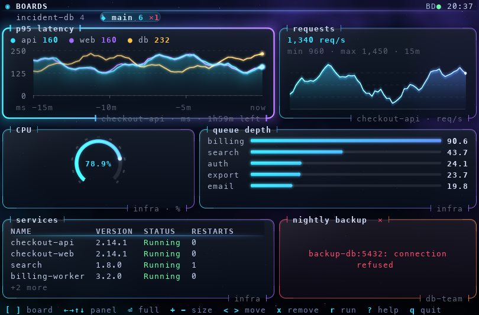
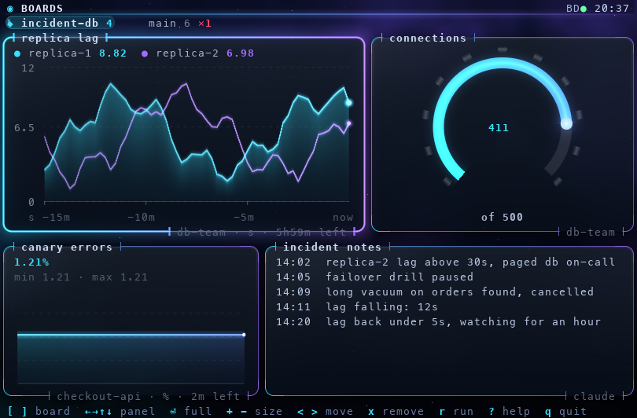

# Boards

Panels that agents and scripts put on your dashboard while it runs: a line graph, a big number, a gauge, bars, a table or text, each fed by a shell command. A Claude Code session chasing a slow endpoint adds a graph of its latency, a cron job adds the size of last night's backup; you arrange them, remove them when you are done, or let them expire. The app shows the boards in a folder, runs each panel's command on its schedule and lays the panels out to fit the window.

It is an example of textual-orbital's boards ([`textual_orbital.boards`](../../README.md#boards): the panel files, `Store`, the output formats, the runner, `BoardsSource` and `BoardsPage`) on one page, with made-up data. It was built for a corner window of about 90x28 cells, and grows to 140x45. With glass (Ghostty) the graphs glow; anywhere else the same layout is text, with braille lines.

| | |
| --- | --- |
|  |  |
| The main board: every kind, and a panel whose command fails | The incident board: a panel that expires in a few minutes, and inline notes |

*Approximate composites drawn by the test harness from the app's real byte stream in a pty, not screenshots of Ghostty: no animation, no dim text, and the font and cell size differ from your terminal.*

- [Run it](#run-it)
- [Add panels](#add-panels)
- [Copy it into a project of your own](#copy-it-into-a-project-of-your-own)
- [Files](#files) and [tests](#tests)

## Run it

From the repository root, in Ghostty:

```sh
uv sync --all-packages
uv run python textual-orbital/examples/boards/app.py --demo       # two boards of made-up data
uv run python textual-orbital/examples/boards/app.py              # the boards in $BOARDS_DIR or ~/.cache/boards
```

| Option | What it does |
| --- | --- |
| `--demo` | A fresh temporary folder with the demo's panels (`boards/seed.py`), deleted when the app quits. |
| `--dir DIR` | The boards in `DIR` (default: `$BOARDS_DIR`, or `~/.cache/boards`). |
| `--plain` | Stock Textual, no glass: the same layout in text. |

The demo has two boards. `main`: p95 latency of three services (a graph that expires in two hours), requests (a stat with its history), CPU (a gauge), queue depth (bars), services (a table whose statuses change by the minute) and a nightly backup whose command fails. `incident-db`: replica lag (a graph), connections (a gauge out of 500), canary errors (a stat that expires in three minutes) and the incident's notes (inline text, no command). The commands are `boards/feed.py`, which makes up values from the time: a metrics query API's JSON, single numbers, `label number` lines and a table.

| Key | What it does |
| --- | --- |
| `[` `]` | The previous and next board |
| arrows, `tab` | Move between panels |
| `enter` | The panel full screen: a big version, its command and when it last ran (`esc` back, `r` run it now) |
| `+` `-` | Grow and shrink the panel (small, medium, large) |
| `<` `>` | Move it earlier and later on its board |
| `x` | Remove it (`y` to confirm) |
| `r` | Run it now |
| `h` | Source health |
| `?` | Keys and the legend |
| `q` | Quit |

What you see:

- **The board row** at the top: every board with its panel count, the current one marked (`◆ main 6`), and how many of a board's panels are failing (`✕1`).
- **The panels**, packed by size so every row is full: small for a number or a gauge, medium for the others, large when you grow one; a lone panel fills the page. More than fit: the page scrolls.
- **Each panel's title** (with the newest value when it has one line), its body, and a faint footer: who added it, the unit and the time left before it expires.
- **A failing panel** keeps its last good data, dimmed, with the error in red on its bottom line and a red border.
- **The key bar** says how many panel files can't be read, if any (their names: `Store(...).problems`).

## Add panels

With the app running, anything that writes a file adds a panel; it shows within a couple of seconds. The folder's format, the output formats, how commands run and the layout are in textual-orbital's [README](../../README.md#boards). In Python:

```python
from datetime import datetime, timedelta, timezone

from textual_orbital.boards import PanelSpec, Store

store, now = Store(), datetime.now(timezone.utc)  # $BOARDS_DIR, or ~/.cache/boards
store.add(PanelSpec(id=store.new_id(), board="machine", title="Processes", kind="table", every=10.0,
                    cmd="ps -Ao pid,pcpu,comm -r | head -8", added_at=now, expires_at=now + timedelta(hours=1)))
```

A few commands to try, as `cmd` with their `kind`:

| Panel | `kind` | `cmd` |
| --- | --- | --- |
| Ping, in ms | `timeseries` | `ping -c1 1.1.1.1 \| sed -n 's/.*time=\([0-9.]*\).*/\1/p'` (one number a run: the graph builds as it runs) |
| Disk, in % | `gauge` | `df -k / \| awk 'NR==2 {print 100*$3/$2}'` |
| Processes | `table` | `ps -Ao pid,pcpu,comm -r \| head -8` |
| Containers | `table` | `docker ps --format 'table {{.Names}}\t{{.Status}}'` |
| Requests per second | `timeseries` | `curl -s "$METRICS/api/v1/query_range?query=...&start=$PANEL_START&end=$PANEL_END&step=$PANEL_STEP"` |

**Commands in panel files run as you, so whoever can write the folder can run commands as you.** Keep it private (the store makes it `0700`). For agents, give the app a front door: a small CLI whose `add` runs the command once, prints what it read or the error, and only then writes the panel, run by the agent in its own shell so its permission prompt shows the command; and a Claude Code skill that says when a panel helps and how to call the CLI. This example has neither; textual-orbital's README has the [`add` in a few lines](../../README.md#security).

## Copy it into a project of your own

The folder is self-contained: copy it, give it a `pyproject.toml`, and install the two libraries from GitHub.

```sh
cp -R textual-glass/textual-orbital/examples/boards my-boards && cd my-boards
uv init --bare --name my-boards
uv add "textual-glass[testing] @ git+https://github.com/misterek/textual-glass#subdirectory=textual-glass" \
       "textual-orbital @ git+https://github.com/misterek/textual-glass#subdirectory=textual-orbital"
uv add --dev pytest
uv run python app.py --demo
uv run pytest
```

`testing` brings the pty harness and the kitty model the tests use.

## Files

| Path | What |
| --- | --- |
| `app.py` | Runs the app (`boards.app.main`). |
| `boards/app.py` | The app: a header, `BoardsPage` over a `BoardsSource`, the key bar (with the count of unreadable panel files), help and source health; `remove_panel` and `arrange_panel` write through the `Store`; `--demo`, `--dir`, `--plain`. |
| `boards/seed.py` | The demo's panels (`seed(store)`), and `python_first`, which makes `python3` in their commands the Python running the app. |
| `boards/feed.py` | Fake data commands, stdlib only, deterministic from the time: `series` (a metrics query API's JSON over `$PANEL_START` to `$PANEL_END`), `value`, `labels`, `table`. |
| `tests/` | See [Tests](#tests). |

## Tests

From the repository root (the workspace's `uv run pytest` runs them too):

```sh
uv run pytest textual-orbital/examples/boards/tests        # about a minute
BOARDS_PNG_DIR=/tmp/boards uv run pytest textual-orbital/examples/boards/tests/test_pty.py   # keep the composites
```

| File | Checks |
| --- | --- |
| `tests/test_pty.py` | The app in a real pty: the demo through every key at 90x28 (boards, the full view, the remove confirmation, help), a folder of every kind whose commands print the same thing every second sending nothing once they have run (not one graphics command, not one byte while the minute holds), `--plain` sending no graphics, a clean protocol and every image deleted on exit; and the demo's seed. It writes approximate composite PNGs to `$BOARDS_PNG_DIR`, or else to a temporary folder of pytest's. |
| `tests/test_end_to_end.py` | The whole loop: panels written and removed through `Store` while the app runs (a new board, a replace by key, a remove), `+` saved in the panel's file, and `x` `y` removing a panel from the screen and from disk. |
| `tests/conftest.py` | Puts the `boards` package on the path; `output` captures what glass writes; `boards_dir` points `$BOARDS_DIR` at a fresh temporary folder; no test opens a browser, plays a sound or leaves a hard-exit entry behind. |

## Limitations

- Only tested headlessly, like the libraries: the final check is you, looking at Ghostty.
- macOS and Linux only: commands run under `/bin/sh` and the store locks with `fcntl`.
- The folder is local: panels added on another machine don't show.
