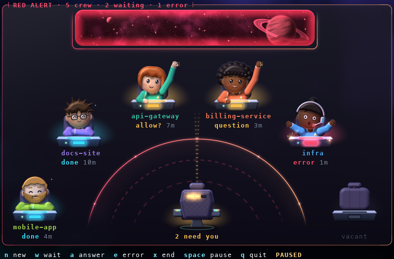
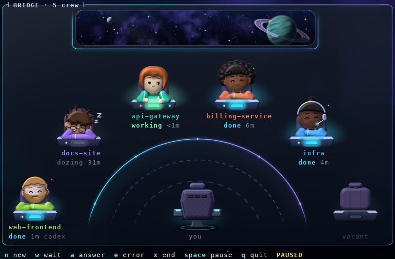

# The bridge

Every Claude Code and Codex session on your machine is a little crew member at a console on a starship bridge. They type while the session works, lean back when it's your move, raise a hand when it needs you (then wave, then stand up and turn to your chair), jolt when a turn dies on an error, sip tea while the context compacts, and doze off when nobody has needed them for half an hour. Running subagents stand beside the console as little ensigns. Two crew waiting on you, or any error, is red alert.

It is an example of [textual-glass](../../../textual-glass/README.md) (sprites, light in the backdrop, a flourish) with textual-orbital's theme and ages, built for a corner window of about 90x28 cells; it also fits 70x22 and grows to 140x45. With glass (Ghostty) the crew are drawn in pixels; anywhere else the same layout is text.

| | |
| --- | --- |
|  |  |
| Red alert: two crew wait on you (a permission and a question) and one turn died on an error | Calm: one at work, the others done or dozing; `web-frontend` is a Codex session |

*Approximate composites drawn by the test harness from the app's real byte stream in a pty, not screenshots of Ghostty: no animation, no dim text, and the font and cell size differ from your terminal.*

- [Run it](#run-it)
- [Replace the crew](#replace-the-crew)
- [Hook it up to Claude Code and Codex](#hook-it-up-to-claude-code-and-codex)
- [How events become states](#how-events-become-states)
- [Copy it into a project of your own](#copy-it-into-a-project-of-your-own)
- [Files](#files) and [tests](#tests)

## Run it

From the repository root, in Ghostty:

```sh
uv sync --all-packages
uv run python textual-orbital/examples/bridge/app.py              # the scripted fake bridge: time runs 20x
uv run python textual-orbital/examples/bridge/app.py --live       # your own sessions (hook them up first)
```

| Option | What it does |
| --- | --- |
| `--live` | Your sessions, from `$BRIDGE_STATE` or `~/.cache/bridge/sessions` (where the hook writes). |
| `--state DIR` | Your sessions from another folder (implies `--live`). |
| `--pack DIR` | Another crew (see [Replace the crew](#replace-the-crew)). |
| `--speed N` | The fake's time compression (default 20). |
| `--plain` | Stock Textual, no glass: the same layout in text. |
| `--print-hooks claude\|codex` | Print the hook registration for that agent, with this checkout's paths, and exit. |

Without `--live` the app plays a fake bridge: made-up hook events go through the real hook into a temporary folder, and the app reads that folder exactly as it reads the real one. The script is a 40-minute loop (two real minutes at the default speed) in which four sessions and two visitors between them go through every state: subagents coming and going, a permission wait that escalates from a hand up to waving to standing, a question at the same time (red alert), a tool failure's spark, compacting, an error, a long idle that dozes off, and the visitors arriving and leaving. The second visitor is a Codex session: a permission, a failed model request and its retry, a question, an interrupt. Ages on screen are in the fake's compressed time.

| Key | What it does |
| --- | --- |
| `n` | A new session comes aboard (in the fake) |
| `w` | Someone asks for permission (in the fake) |
| `a` | Answer everyone who is waiting (in the fake) |
| `e` | A turn dies on an error (in the fake) |
| `x` | The newest session ends and leaves its station (in the fake) |
| `space` | Pause the fake's script and its clock, and resume |
| `q` | Quit |
| `f9`, `shift+f9` | Glass's motion level; glass off and on |

What you see:

- **Six stations** on an arc around your chair. A new session takes the first free station (the two in the middle first, the front corners last) and keeps it, with the first crew member nobody present has. Under each: the project (the folder the session runs in) in the member's colour, then the state and its age (`working 3m`, `allow? 1m`, `question 4m`, `done 12m`, `error <1m`), and on big windows the model. `ϟ` after the age: a tool failed in the last minute. A faint `codex` (or `cx` where the line is short) after the age: a Codex session; Claude Code's have no tag. The console lamp: green working, amber waiting, red error, cyan done, dim idle.
- **The room**, drawn in light in glass's backdrop, nothing opaque: a rail in front of the stations, two dashed rings round your chair, a pool of light behind each console in its lamp's colour, and a dotted path of light from each crew member who waits on you to your chair.
- **The viewscreen** across the top, at the terminal's full pixel size, in a glass pane. Red alert tints it and turns the pane, the rail, the rings and the panel's border red.
- **The captain's chair**: you. It glows amber and says how many crew need you while anyone waits.
- A pulsar plays over a station when its crew member raises a hand.

The panel's title counts the crew, the waiting and the errors. A seventh session and beyond wait "below deck" until a station frees up.

## Replace the crew

The art comes from a crew pack. The built-in crew is six members drawn smooth at every size, lit by their console lamps. [`PACKS.md`](PACKS.md) documents everything; there are two ways in.

**Your own people, quickly.** A folder with a `pack.json` that extends the built-in crew and describes your members: names, colours, a hair style, extras. The art is drawn for you, in every pose.

```json
{
  "name": "my-crew",
  "style": "smooth",
  "extends": "smooth",
  "members": [
    {"id": "kit", "name": "Kit", "uniform": "#ff9f43", "colors": {"skin": "#d9a27c", "hair": "#2b1d14"},
     "hair_style": "curly", "extras": ["glasses", "headset"]}
  ]
}
```

**Your own pictures.** A pack in the `picture` style: a folder per member with a PNG per pose (numbered frames animate it), on a 464 x 400 canvas. The bridge draws the console, the chair, the lamp's light, the ensigns and the effects round them and scales them to each station's size. `seated` and `hand_up` are required; a pose you leave out borrows a near one. Start from the built-in crew, exported as a pack to paint over (with a `guide.png` of the canvas):

```sh
cd textual-orbital/examples/bridge
uv run python tools/export_pictures.py --out ~/my-crew --stills    # one picture per pose; without --stills, every frame
uv run python app.py --pack ~/my-crew
```

Try either kind with `--pack DIR`. A broken pack stops at startup with the file and the problem.

## Hook it up to Claude Code and Codex

`bridge/hook.py` is the hook for both agents: stdlib only, Python 3.10 or later, about 20 ms a call. It reads one hook event on stdin and keeps one small JSON file per session in `$BRIDGE_STATE` (default `~/.cache/bridge/sessions`), written atomically. It prints nothing and always exits 0, whatever it is fed, so a broken hook never disturbs the agent. `--agent codex` says the events come from Codex; without it they come from Claude Code. On `SessionStart` it deletes the files of sessions gone for two days (ended ones after an hour).

Nothing is installed for you. Run these commands from the repository root. `--print-hooks` prints the registration for one agent, with the absolute path of this checkout's `hook.py` and of the Python that ran it, and never writes any settings. The JSON goes to stdout and where to put it to stderr, so you can redirect it straight into a file:

```sh
uv run python textual-orbital/examples/bridge/app.py --print-hooks claude
```

```json
{
  "hooks": {
    "SessionStart": [
      {"hooks": [{"type": "command",
                  "command": "/path/to/textual-glass/.venv/bin/python3 /path/to/textual-glass/textual-orbital/examples/bridge/bridge/hook.py --agent claude"}]}
    ],
    "PreToolUse": [
      {"matcher": "*", "hooks": [{"type": "command", "command": "... the same command ..."}]}
    ]
  }
}
```

(shortened: it lists every event in [the table below](#how-events-become-states); the tool events take the matcher `*`, every tool). Then run the bridge with `--live` in a corner window. Sessions that were already running show up at their next event. The printed command names this checkout's own Python, so after moving the checkout or recreating its `.venv`, print and register the hooks again. To see what the hook writes: `cat ~/.cache/bridge/sessions/*.json`.

### Claude Code

**One session at a time.** Claude Code's `--settings` loads a file for that session only, on top of your usual settings:

```sh
uv run python textual-orbital/examples/bridge/app.py --print-hooks claude > ~/bridge-hooks.json
claude --settings ~/bridge-hooks.json        # in each terminal you want on the bridge
```

**Every session.** Merge the printed `"hooks"` into `~/.claude/settings.json` (keep any hooks you already have). It then runs for every Claude Code session on the machine, on every tool call. Remove the entries to stop it. `/hooks` in Claude Code lists what is registered.

### Codex

**Untested against a real Codex session.** The Codex side was built from the [Codex hooks documentation](https://developers.openai.com/codex/hooks) and the event schemas of codex-cli 0.167, and is checked by the tests with made-up events only.

Codex reads the same `{"hooks": {...}}` shape from a `hooks.json`. `~/.codex/hooks.json` is every Codex session. If you already have one, merge the printed `"hooks"` into it; the redirect below replaces the file, so use it only when there is none:

```sh
uv run python textual-orbital/examples/bridge/app.py --print-hooks codex > ~/.codex/hooks.json
```

For one project's sessions only, put it in that project's `.codex/hooks.json` (Codex loads project hooks only once you trust the project). Either way, Codex runs a new or changed hook only after you review and trust it: open `/hooks` in Codex and trust the bridge's entries. Hooks are on by default; `[features] hooks = false` in `~/.codex/config.toml` turns them all off.

What Codex can't show, because it has no hook event for it:

- **Tool failures:** no spark, because Codex has no `PostToolUseFailure`.
- **Questions outside plan mode:** Codex has no `Notification`. A question in plan mode (its `request_user_input` tool) is a hand up as `question`; anything else Codex waits on shows as working.
- **Errors, approximately:** Codex has no failure event. The hook reads its `PostModelRequest`: a failed model request is an error, and the next one that completes goes back to working. Codex retries a failed request a few times, so a retry that gets through shows a short error first.

## How events become states

Each event changes the session's state, and the state and its age pick the pose.

| Event (Claude Code) | Event (Codex) | State |
| --- | --- | --- |
| `SessionStart` | `SessionStart` | `seated` (after a compaction, unchanged) |
| `UserPromptSubmit`, `PreToolUse`, `PostToolUse` | the same | `working` |
| `PermissionRequest`; `Notification` `permission_prompt` | `PermissionRequest` | `waiting` (permission) |
| `Notification` `elicitation_dialog`, `agent_needs_input` | `PreToolUse` of `request_user_input` | `waiting` (question) |
| `Notification` `idle_prompt` | | unchanged (it only confirms `done`) |
| `Stop` | `Stop`, `Interrupt` | `done` |
| `StopFailure` | `PostModelRequest` with `status` `failed` | `error` |
| | `PostModelRequest` `completed` after an error | `working` |
| `PostToolUseFailure` | | unchanged, but a spark for a minute (none for an interrupt) |
| `PreCompact` | `PreCompact` | `compacting` (a subagent's: unchanged) |
| `PostCompact` | `PostCompact` | back to the state before `PreCompact`, with its old age (a subagent's: unchanged) |
| `SubagentStart`, `SubagentStop` | the same | an ensign comes or goes |
| `PostModelSwitch` | the `model` on every event | the model changes |
| `SessionEnd` | `SessionEnd` | `ended`: the crew member leaves, shown for a minute |

- **Every request is a hand of its own, and only its answer lowers it.** The hook keeps a list of open waits, one per tool call that asks: `PermissionRequest` for a permission, `PreToolUse` of `request_user_input` for a question. A wait closes when its own call's `PostToolUse` (or `PostToolUseFailure`) arrives, so a parallel tool finishing, or another subagent's call, leaves it up. The session is `waiting` while any wait is open, and the oldest open wait gives the kind and the age. Underneath, the session keeps what it is doing (working, done, compacting...), which shows again when the last wait closes: `done`, if the turn ended meanwhile.
- **A request finds its call by its id, or by what it asks.** `PermissionRequest` carries no `tool_use_id` in either agent, so the hook takes the id of the call's `PreToolUse` with the same agent, tool and input, and otherwise keys the wait on that agent, tool and input. A command is matched on the command alone, because Codex's request adds a `description` of why it asks.
- **A notification with no request behind it is a wait of its own.** A waiting `Notification` (a sandboxed command's network access, an MCP form) opens a wait no call is known for, unless a wait of its kind is already open (from the same agent, or from anyone when the notification names none): the ~6 s reminder of a request is the same wait. The asker's next tool event lowers such a wait, even a parallel call's: with no call to match, it is the best sign there is.
- **What lowers every hand, and what lowers some.** A new prompt, `Interrupt`, `SessionEnd` and a new `SessionStart` lower them all. `Stop` (and `StopFailure`) lower the session's own; a subagent's request outlives the turn. `SubagentStop` lowers that subagent's. Compaction never touches them, and a subagent's `PreCompact` and `PostCompact` leave the session as it was. A background subagent working after `Stop` leaves the session `done`; its ensign shows the work.
- **A hand can stay up longer than the question.** Neither agent sends an event when you approve or deny. After you approve a long-running command, the hand stays up until the command finishes (or the turn ends). A denied permission's hand stays up until the next prompt, `Stop` or `Interrupt` (Claude Code's `PermissionDenied` is only for auto mode's own denials, and `PostToolUseFailure` skips denials). A hand up too long beats a hand hidden while it still needs you.
- **An unknown event is ignored, and so is a missing or odd field.** Check the event names against your version with `/hooks` (both agents have it): an event the agent doesn't know is never sent.

| State | Pose | Status |
| --- | --- | --- |
| no session | empty | `vacant` |
| `seated` | seated | `seated` |
| `working` | typing | `working` |
| `done` | done, then dozing after 30 minutes | `done`, `dozing` |
| `waiting` | hand up, waving after 2 minutes, standing after 10 | `allow?` or `question` |
| `error` | jolt | `error` |
| `compacting` | tea | `compacting` |
| `ended` | leaves the station | `left` |

The state file holds `session_id`, `agent` (`claude` or `codex`), `cwd`, `project`, `state`, `waiting_kind` (`permission` or `question`), `since` (when the state last changed), `started`, `updated`, `model`, `subagents` (running agent ids), `spark_at`, `error`, `last_event`, `resume_state` and `resume_since` while compacting, `activity` (the state under any open waits), `waits` (the open waits, oldest first, each with its `actor`, `""` for the session itself, `kind`, `key` and `since`; at most 16) and `calls` (tool calls in flight, as `[key, tool_use_id]`, so a `PermissionRequest` finds its call). A file from before `waits` (with `waiting_agent`) reads as one wait for whoever asked.

## Copy it into a project of your own

The folder is self-contained: copy it, give it a `pyproject.toml`, and install the two libraries from GitHub.

```sh
cp -R textual-glass/textual-orbital/examples/bridge my-bridge && cd my-bridge
uv init --bare --name my-bridge
uv add "textual-glass[images,testing] @ git+https://github.com/misterek/textual-glass#subdirectory=textual-glass" \
       "textual-orbital[images] @ git+https://github.com/misterek/textual-glass#subdirectory=textual-orbital"
uv add --dev pytest pytest-asyncio
uv run python app.py
```

`images` brings Pillow, for picture packs; `testing` brings the pty harness and the kitty model the tests use. For the tests, add to `pyproject.toml`:

```toml
[tool.pytest.ini_options]
asyncio_mode = "auto"
asyncio_default_fixture_loop_scope = "function"
```

Then `uv run pytest`. `--print-hooks` prints the new folder's paths; print the registration again after you move it.

## Files

| Path | What |
| --- | --- |
| `app.py` | Runs the app (`bridge.app.main`). |
| `bridge/app.py`, `bridge/bridge.tcss` | The app: polls the state folder once a second and touches only the widgets whose look changed; the options, `--print-hooks`. What it shows is `Bridge` (the folder read, the sessions seated, a `Deck` updated), apart from the app, so another app can put the bridge on a page of its own. |
| `bridge/hook.py` | The hook: events in, state files out. Its `EVENTS` lists what each agent sends. |
| `bridge/state.py` | `Session`, `SessionReader` (re-reads only changed files), `pose_for`, `red_alert`, the seating chart. |
| `bridge/fake.py` | The scripted fake bridge and the keys that drive it. |
| `bridge/widgets.py` | The stations, the viewscreen (column tiles of at most `SPRITE_MAX_PX` each, cut from one picture, so it is never stretched), the chair, and the deck that lays them out on an arc for the window's size and lights the room: the `Arc`, `Pool`, `Path` and `Pane` items, each with its own ident, so a state change redraws only its pool and its path. |
| `bridge/room.py` | Where the room's light goes and how it falls off, each item's light ending inside its box (glass rule 16): pure numpy, no Textual. |
| `bridge/crew/` | The art ([`PACKS.md`](PACKS.md)). |
| `tools/` | `crew_sheet.py` (contact sheets of a pack), `export_pictures.py` (a starter picture pack). |
| `tests/` | See [Tests](#tests). |

## Tests

From the repository root (the workspace's `uv run pytest` runs them too):

```sh
uv run pytest textual-orbital/examples/bridge/tests        # about two minutes
BRIDGE_PNG_DIR=/tmp/bridge uv run pytest textual-orbital/examples/bridge/tests/test_pty.py   # keep the composites
```

| File | Checks |
| --- | --- |
| `tests/test_state.py` | The hook, event by event for both agents (Codex's interrupt, failed and retried requests, its question tool, the model on every event), missing and odd fields, the script's exit code and silence, atomic writes and concurrent hooks, pruning; the session model, poses by age, red alert, the seating chart; the fake's script, its Codex visitor and its keys. |
| `tests/test_app.py` | The app in Textual's pilot with glass forced on: sprites per station and their keys, idle silence, ages at minute resolution, red alert, the keys, a failing poll, the arc at three sizes and crisp on Retina cells, the text fallback, the room's light (static items, partial redraws, red alert), the viewscreen's tiles, the Codex tag, and `--print-hooks` (its registration run as printed). |
| `tests/test_room.py` | The room's light by itself: where it goes, glass rule 16 for each item, partial redraws, a dark floor under the labels. |
| `tests/test_pty.py` | The app in a real pty at 70x22, 90x28 and 140x45: a clean protocol, every image deleted on exit, every cell background default, silence while paused, the demo's keys and a resize. It writes approximate composite PNGs to `$BRIDGE_PNG_DIR`, or else to a temporary folder of pytest's. |
| `tests/test_crew.py` | The art: every pose and size, transparent borders (glass rule 17), packs that load and packs that don't. |
| `tests/conftest.py` | Puts the `bridge` package on the path; `output` captures what glass writes; no test opens a browser or leaves a hard-exit entry behind; glass draws for the harness's 9x19 px cells. |

## Limitations

- **Codex is untested against a real session**, and can't show tool failures or most questions (see [Codex](#codex)).
- Only tested headlessly, like the libraries: the final check is you, looking at Ghostty.
- Sessions on another machine don't show; the hook writes to a local folder.
- Up to six sessions have a station; the rest are counted "below deck".
